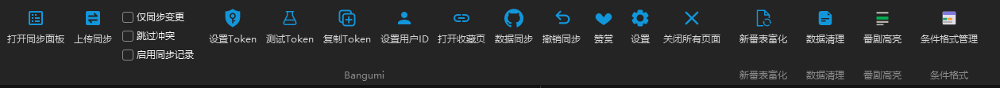
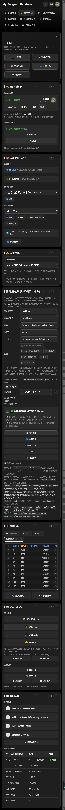
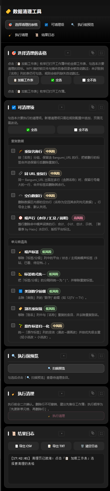

[](LICENSE)
[](https://www.typescriptlang.org/)
[](#sec-5)
[](https://github.com/awujiana)
[](#sec-13)

[](https://github.com/awujiana/My-Bangumi-Database-for-WPS/releases)
[](https://github.com/awujiana/My-Bangumi-Database-for-WPS/stargazers)
[](https://github.com/awujiana/My-Bangumi-Database-for-WPS/issues)

<div align="center">

[](images/mbd-logo.svg)

<h1>My Bangumi Database for WPS</h1>
<h2>My-Bangumi-Database-for-WPS</h2>

<strong>Manage your Bangumi anime data inside WPS Spreadsheets: upload sync, data sync, collection download, enrich and cleanup</strong>

</div>

> [!WARNING]
> A substantial part of this project was written with AI assistance and has since gone through continuous manual work, integration testing and refactoring. Even so, it may still contain omissions, insufficient edge-case handling, or behaviour that does not fully match expectations. If you run into a bug, a compatibility problem, unexpected behaviour or missing documentation, please open an Issue. Reproduction steps, logs, screenshots and your system version help a lot.

<p align="center">
  <strong>Language</strong>: 
  <a href="README.md">简体中文</a> ·
  <a href="README.zh-TW.md">繁體中文</a> ·
  <a href="README.en.md">English</a>
  &nbsp;&nbsp;|&nbsp;&nbsp;
  <strong>Docs</strong>: 
  <a href="#sec-11">Documentation index</a> ·
  <a href="CONTRIBUTING.md">Contributing</a> ·
  <a href="CHANGELOG.md">Changelog</a> ·
  <a href="文档/待办-多语言支持.md">i18n notes (zh-CN)</a>
</p>

## 📚 Table of contents

- [Overview](#sec-1)
- [Highlights](#sec-2)
- [Accessibility and design baseline](#sec-2a)
- [Screenshots](#sec-2b)
- [Tech stack](#sec-3)
- [Repository layout](#sec-4)
- [Requirements](#sec-5)
- [Installing into WPS](#sec-5b)
- [Updating to a new version](#sec-5c)
- [Development and debugging](#sec-6)
- [Build and packaging](#sec-7)
- [Configuration backup and update safety](#sec-7b)
- [Usage examples](#sec-8)
- [Testing](#sec-9)
- [Code style and contributing](#sec-10)
- [Documentation index](#sec-11)
- [Roadmap (TODO)](#sec-11b)
- [Data source](#sec-12)
- [Feedback](#sec-13)
- [Credits](#sec-13b)
- [Donate](#sec-13c)
- [License](#sec-14)

<a id="sec-1"></a>

## 🚀 Overview

**My Bangumi Database for WPS** is a spreadsheet add-in that runs inside **WPS Office** and moves data both ways between your local workbook and [Bangumi](https://bgm.tv/):

- **Upload sync** — push watch status / ratings / tags from the sheet back to Bangumi in bulk;
- **Data sync** — pull Bangumi metadata from the public data repository and merge it into the sheet by SID;
- **Collection download** — mark your Bangumi collection list onto the sheet;
- **Enrich / cleanup / highlight / conditional formatting** — keep a long-lived anime tracking sheet tidy.

The data source is the sister repository [Bangumi-Archive-Anime-Excel](https://github.com/awujiana/Bangumi-Archive-Anime-Excel), which processes the official Bangumi Archive dump every week. Syncing data needs no Token.

> [!IMPORTANT]
> **Network note: `https://bgm.tv/` is not directly reachable from mainland China.** Upload sync, collection download and token verification all talk to Bangumi directly, so you need your own proxy / accelerator and must make WPS route its requests through it. Please sort out your own network environment. If you only want to organise data offline, use **Data sync** (GitHub / GitLab / Gitee / Gist / local file) — that path never touches bgm.tv.

---

<a id="sec-2"></a>

## ✨ Highlights

| Capability                              | Description                                                                                                                                                                                                                                                                                                                                                                                                                                                                                                                                                                                                                                                                                                                                                                                                                                                                                                                                                                                                                                                                                                                                                                                                                                                                                                                                                                                                                                                                                                                                                                                                                                                                                                                                                                                                                                                                                                       |
| --------------------------------------- | ----------------------------------------------------------------------------------------------------------------------------------------------------------------------------------------------------------------------------------------------------------------------------------------------------------------------------------------------------------------------------------------------------------------------------------------------------------------------------------------------------------------------------------------------------------------------------------------------------------------------------------------------------------------------------------------------------------------------------------------------------------------------------------------------------------------------------------------------------------------------------------------------------------------------------------------------------------------------------------------------------------------------------------------------------------------------------------------------------------------------------------------------------------------------------------------------------------------------------------------------------------------------------------------------------------------------------------------------------------------------------------------------------------------------------------------------------------------------------------------------------------------------------------------------------------------------------------------------------------------------------------------------------------------------------------------------------------------------------------------------------------------------------------------------------------------------------------------------------------------------------------------------------------------- |
| 📤 **Upload sync**                      | Batch-sync watch status, ratings and tags from the sheet to the Bangumi API (exponential backoff retries + request race protection).                                                                                                                                                                                                                                                                                                                                                                                                                                                                                                                                                                                                                                                                                                                                                                                                                                                                                                                                                                                                                                                                                                                                                                                                                                                                                                                                                                                                                                                                                                                                                                                                                                                                                                                                                                              |
| 📥 **Data sync**                        | Download Bangumi metadata JSONL from a remote repository (GitHub / GitLab / Gitee / Gist / local file) and merge it into the sheet incrementally, with a 24-hour local cache and DJB2 hash comparison.                                                                                                                                                                                                                                                                                                                                                                                                                                                                                                                                                                                                                                                                                                                                                                                                                                                                                                                                                                                                                                                                                                                                                                                                                                                                                                                                                                                                                                                                                                                                                                                                                                                                                                            |
| ↩️ **Collection download**              | Pull your collection list from Bangumi and mark it onto the sheet; when the sheet is empty it can first fill in the entries from your Bangumi account.                                                                                                                                                                                                                                                                                                                                                                                                                                                                                                                                                                                                                                                                                                                                                                                                                                                                                                                                                                                                                                                                                                                                                                                                                                                                                                                                                                                                                                                                                                                                                                                                                                                                                                                                                            |
| 🔄 **5 sync strategies**                | `add-update` / `add-only` / `update-only` / `mirror` / `force-overwrite`.                                                                                                                                                                                                                                                                                                                                                                                                                                                                                                                                                                                                                                                                                                                                                                                                                                                                                                                                                                                                                                                                                                                                                                                                                                                                                                                                                                                                                                                                                                                                                                                                                                                                                                                                                                                                                                         |
| ✅ **Sync preferences**                 | Incremental sync, skip conflicts, sync-record toggle, default collection list type, default time filter, auto-refresh interval; "undo sync" based on the sync records.                                                                                                                                                                                                                                                                                                                                                                                                                                                                                                                                                                                                                                                                                                                                                                                                                                                                                                                                                                                                                                                                                                                                                                                                                                                                                                                                                                                                                                                                                                                                                                                                                                                                                                                                            |
| 🎨 **Appearance**                       | Dark / light / follow-system / scheduled — four modes. The settings page has a day-night switch (sun / moon slider) that expands from the button centre, and you can set the start and end times.                                                                                                                                                                                                                                                                                                                                                                                                                                                                                                                                                                                                                                                                                                                                                                                                                                                                                                                                                                                                                                                                                                                                                                                                                                                                                                                                                                                                                                                                                                                                                                                                                                                                                                                 |
| 🌐 **Multilingual**                     | Simplified Chinese / Traditional Chinese / English, **1858 keys each, 100% coverage**. Switching takes effect immediately (ribbon button labels need a WPS restart). Language packs ship with the add-in; the settings page can "Update language packs" (download → verify SHA-256 → write; a corrupt pack writes not a single byte) or "Open language pack folder" to drop one in manually.                                                                                                                                                                                                                                                                                                                                                                                                                                                                                                                                                                                                                                                                                                                                                                                                                                                                                                                                                                                                                                                                                                                                                                                                                                                                                                                                                                                                                                                                                                                      |
| ⌨️ **Shortcuts**                        | Six panel jumps can be bound to custom key combinations (record-to-rebind; a duplicate combo is rejected and the current owner is named). Sidebar navigation supports middle-click / Ctrl+click gestures (focus / hide).                                                                                                                                                                                                                                                                                                                                                                                                                                                                                                                                                                                                                                                                                                                                                                                                                                                                                                                                                                                                                                                                                                                                                                                                                                                                                                                                                                                                                                                                                                                                                                                                                                                                                          |
| 🧩 **Module ordering**                  | Every page's modules can be dragged or moved with ↑↓; the eye button hides them one by one, and the whole sidebar navigation can be hidden in one click so the main area uses the full width in a narrow task pane.                                                                                                                                                                                                                                                                                                                                                                                                                                                                                                                                                                                                                                                                                                                                                                                                                                                                                                                                                                                                                                                                                                                                                                                                                                                                                                                                                                                                                                                                                                                                                                                                                                                                                               |
| 🎛️ **Conditional formatting semantics** | **"Apply conditional formatting" is incremental by default**: it only writes the "My rules / default rule sets" into the sheet. Rules that already match on range + formula get their colours refreshed, missing ones are added, and **no existing rule is ever deleted** (hand-made rules and rules from other tools all stay). Only rules this add-in wrote in a previous round and that were removed from the rule library are taken out (tracked per sheet in the `conditionalFormat.applied.v1` ledger). To truly start over, use `🧹 Clear sheet then apply` (a dangerous button that lists everything before asking). After writing, every rule is read back, and rule names that did not land show up directly in the message. "Worksheet rules" can group by formula / range+formula / column / row; "🔗 Merge duplicates" merges several single-row rules with the same formula and column (two modes: consecutive rows only, or force one block), both switchable on the settings page. Each worksheet rule row has ✎ edit (range / formula / colour) and ⧉ duplicate; "Export rules" supports file or clipboard; "My rules" can ⧉ copy the selection and paste several at once (shown as a table, ranges can be unified in bulk); all three places support "✎ bulk edit" of range / formula / colour; "Import worksheet rules" ▾ can also import from a file (a `.json` exported by this project) or from text; the target-worksheet picker automatically switches between single-select and search by option count. All four tables (worksheet rules / my rules / import dialog / paste table) support **dragging column headers to resize columns and dragging the header's bottom edge to resize rows** (double-click the handle to return to auto), and sizes are remembered per sheet; the default is a template that adapts to the pane width, so columns you never dragged never become fixed. |
| 📌 **Anchoring / pinning**              | The group header's "📌" means **anchor the whole column**: it rewrites the rule's applied range to `$J:$J` (or `$J:$L` for several columns) while **leaving the formula untouched**, so adding or deleting rows no longer affects it. "📎 Pin cell" pins it to a single `$J$5`, still applying only to that cell after rows or columns are deleted; "🔧 Restore anchors" fixes drifted ranges in one click. Records travel with the configuration export.                                                                                                                                                                                                                                                                                                                                                                                                                                                                                                                                                                                                                                                                                                                                                                                                                                                                                                                                                                                                                                                                                                                                                                                                                                                                                                                                                                                                                                                         |
| 🗓️ **Season / year filters**            | The highlight page supports "All / Year / Season / Month / Upcoming", using the same semantics as the GitHub sync filter; "Filter rows" hides non-matching rows in the sheet directly.                                                                                                                                                                                                                                                                                                                                                                                                                                                                                                                                                                                                                                                                                                                                                                                                                                                                                                                                                                                                                                                                                                                                                                                                                                                                                                                                                                                                                                                                                                                                                                                                                                                                                                                            |
| 🪄 **Anime sheet enrichment**           | Automatically fills name / alias differences in the tracking sheet and maps infobox fields, cutting down manual typing.                                                                                                                                                                                                                                                                                                                                                                                                                                                                                                                                                                                                                                                                                                                                                                                                                                                                                                                                                                                                                                                                                                                                                                                                                                                                                                                                                                                                                                                                                                                                                                                                                                                                                                                                                                                           |
| 🔑 **Token management**                 | Set, test, copy and clear the Bangumi API Token.                                                                                                                                                                                                                                                                                                                                                                                                                                                                                                                                                                                                                                                                                                                                                                                                                                                                                                                                                                                                                                                                                                                                                                                                                                                                                                                                                                                                                                                                                                                                                                                                                                                                                                                                                                                                                                                                  |
| 🆕 **Update check**                     | Checks GitHub Releases for a new version, shows version and release notes in a dialog with download progress and copyable logs; **one-click automatic install**: after confirmation WPS closes itself, the add-in folder is replaced and WPS reopens (full backup first, rollback on failure, refuses to install when unsaved documents exist).                                                                                                                                                                                                                                                                                                                                                                                                                                                                                                                                                                                                                                                                                                                                                                                                                                                                                                                                                                                                                                                                                                                                                                                                                                                                                                                                                                                                                                                                                                                                                                   |
| 💙 **Donate page**                      | The "Donate" ribbon button opens a page with the author's GitHub, email, QQ group and a WeChat donation QR code.                                                                                                                                                                                                                                                                                                                                                                                                                                                                                                                                                                                                                                                                                                                                                                                                                                                                                                                                                                                                                                                                                                                                                                                                                                                                                                                                                                                                                                                                                                                                                                                                                                                                                                                                                                                                  |
| ⚙️ **Dual-panel UI**                    | The main panel and the settings panel coordinate their docking dynamically; the settings panel has a side navigation (icons-only mode with hover tooltips); a unified `data-action` dispatcher (30+ actions).                                                                                                                                                                                                                                                                                                                                                                                                                                                                                                                                                                                                                                                                                                                                                                                                                                                                                                                                                                                                                                                                                                                                                                                                                                                                                                                                                                                                                                                                                                                                                                                                                                                                                                     |

---

<a id="sec-2a"></a>

## ♿ Accessibility and design baseline

The UI follows [WCAG 2.2 AA](https://www.w3.org/TR/WCAG22/) plus the "10 usability heuristics + Refactoring UI's seven angles". Both themes share one set of tokens (`css/tokens.css`); colours are never hard-coded in components.

**Automated audit scope** (real headless Chrome; 7 pages × dark / light × viewports 320 / 375 / 768 / 1280):

| Check                           | Baseline                                        | Measured   |
| ------------------------------- | ----------------------------------------------- | ---------- |
| Body text contrast              | ≥ 4.5:1 (large text ≥ 3:1)                      | 0 failures |
| Pointer target size             | ≥ 24×24 CSS px (inline links in prose excepted) | 0 failures |
| Whole-page horizontal overflow  | none                                            | 0          |
| Accessible name on icon buttons | `title` / `aria-label` on all                   | 0 missing  |

> This is an automated scan, **not** a compliance certificate: keyboard walkthroughs, real assistive technology (NVDA / Narrator) and real user testing still need to happen by hand.

**Hard rules when changing styles**:

- **Fill colours and text colours are separate**: `--danger` / `--success` / `--accent-blue` are **fill** colours (backgrounds, borders, carrying white text); when used as text they must become `--text-danger` / `--text-success` / `--text-link`. The same value used as text is guaranteed to fail in the light theme (`#2f7fe0` on `#eef0f3` is only 3.51:1).
- **Muted text `--text-3` is already computed against the darkest / lightest backgrounds**: dark `#a0a0a0` (worst 4.69:1), light `#5f646c` (worst 4.72:1). Lighten or darken it further and it drops below 4.5.
- **Gradient backgrounds must be measured per colour stop**, never just by `background-color` — a gradient element's `backgroundColor` is transparent, and walking up to the parent turns "dark text on light background" into a false "dark on dark".
- **Single column at a 320px pane** is a hard requirement; do not squeeze a desktop layout in by shrinking font sizes or hit targets.

---

<a id="sec-2b"></a>

## 🖼️ Screenshots

<p align="center">
  
  
</p>

> Screenshots are taken from the real add-in UI (dark theme); the panel switches between single-column and two-column layouts depending on the WPS version and window width.

---

<a id="sec-3"></a>

## 🧰 Tech stack

- **Language**: TypeScript (strict mode, ES2022 target)
- **Build**: Vite 6 (bundles `dist/`) + `tsc` (compiles `dist-ts/`)
- **Runtime**: WPS Office JSAPI (ET add-in), debugged through the `wpsjs` CLI
- **Code quality**: ESLint 8 (including the `@typescript-eslint/strict-type-checked` tier, 0 errors overall) + Prettier 3 + Husky + lint-staged
- **Testing**: Vitest 4 (with `@vitest/coverage-v8`)
- **Runtime dependencies**: `zod` (data validation), `dompurify` (HTML sanitising)
- **Build-time dependencies**: `@napi-rs/canvas` / `@resvg/resvg-js` (image export)

---

<a id="sec-4"></a>

## 📂 Repository layout

Below is the layout of the release package **`My-Bangumi-Database-for-WPS-v2.4.0.zip`** after extraction (i.e. the files actually loaded by WPS after installation — no sources, tests or docs):

```
My-Bangumi-Database-for-WPS-v2.4.0/
├── index.html                  # Add-in entry point (loaded when WPS starts)
├── main.js                     # Dynamic module loader (early ribbon placeholder, real implementation swapped in later)
├── manifest.xml                # Add-in manifest (ApiVersion / Name)
├── ribbon.xml                  # Ribbon configuration (the "Bangumi Sync" tab)
├── wpsjsrpcsdk.js              # WPS JSAPI RPC SDK
├── assets/                     # Hashed Vite assets
│   ├── main.<hash>.js          # Main entry bundle
│   ├── logger.<hash>.js        # Logging module
│   └── data-export.<hash>.js   # Data export module
├── css/                        # Global and per-page styles
│   ├── tokens.css              # Design tokens (colour / spacing / type scale)
│   ├── styles.css              # Shared components and toasts
│   ├── panel-theme.css         # Panel theme and top bar
│   ├── clean.css
│   ├── conditional-format.css
│   ├── context-menu.css
│   ├── detachable-panel.css
│   ├── diff.css
│   ├── donate.css
│   ├── enrich.css
│   ├── highlight.css
│   ├── sortable-list.css
│   └── update-dialog.css
├── dist-ts/                    # tsc output (runtime dependency)
│   ├── index.js
│   ├── ribbon.js
│   ├── core/                   # Constants, error handling, results, progress, types
│   ├── entry/                  # ribbon / panel / settings entry points
│   ├── panel/                  # Main panel, settings, cleanup, enrich, highlight, conditional format, donate
│   ├── schemas/                # zod validation schemas
│   ├── services/               # Config / ribbon services
│   ├── sync/                   # Sync engine (github / gitlab / gitee / gist / local file / Archive)
│   ├── tools/                  # Utilities (http / wps / logger / sanitize / clipboard ...)
│   └── ui/                     # Panel UI and handlers/
├── images/                     # Ribbon and panel icons (SVG), donation QR code
├── locales/                    # Language packs (Simplified / Traditional / English)
│   ├── index.js                # Manifest (code / version / updatedAt / sha256 / coverage)
│   ├── zh-CN/locale.js         # Simplified Chinese (source language, extracted from ui/*.html data-i18n*)
│   ├── zh-TW/locale.js         # Traditional Chinese
│   └── en/locale.js            # English
├── libs/                       # Bundled third-party runtime libraries
│   ├── fit-viewport.js
│   ├── purify.js               # DOMPurify UMD
│   ├── purify.min.js.map
│   └── wps-sdk-loader.js
└── ui/                         # Panel HTML
    ├── sync-panel.html         # Sync panel
    ├── settings.html           # Settings panel
    ├── clean.html              # Data cleanup
    ├── conditional-format.html # Conditional formatting
    ├── donate.html             # Donate page
    ├── enrich.html             # Anime sheet enrichment
    └── highlight.html          # Anime highlight
```

> The tree above is what the **`publish` branch / release zip** contains. The default branch **`main`** is the full source workspace: on top of the above it also has `tests/`, `scripts/`, `package.json` and `tsconfig*` / `vite.config`, so after `git clone` + `npm install` you can run `npm run gate` / `npm run build`.

<details>
<summary>📂 ts/ source layout (for reference)</summary>

```
ts/
├── core/        # Constants, types, results, error handling, UI bridge
├── entry/       # ribbon / panel / settings entry points
├── panel/       # Main panel, settings, cleanup, enrich, highlight, conditional format, donate
├── schemas/     # zod validation schemas
├── services/    # Config / ribbon services
├── sync/        # Sync engine (github / gitlab / gitee / gist / local file / Archive)
├── tools/       # Utilities (http / wps / logger / sanitize / clipboard / theme ...)
├── ui/          # DOM components, dialogs, handlers (data-action dispatch)
├── index.ts
└── ribbon.ts
```

</details>

---

<a id="sec-5"></a>

## 🔧 Requirements

| Dependency | Version                       | Notes                                                 |
| ---------- | ----------------------------- | ----------------------------------------------------- |
| WPS Office | 2019+ (Windows)               | Must support JSAPI / add-in debugging (`wpsjs debug`) |
| Node.js    | 18+ (LTS 20 / 22 recommended) | Build and debug toolchain                             |
| npm        | ships with Node               | Package management                                    |
| Git        | a recent version              | Version control                                       |

---

## 📥 Developer setup (development only)

> These steps are for **developing the add-in itself** and must be run on the default branch `main` (the `publish` branch only holds release files and has no `package.json` or build config, so `npm install` fails there). If you just want to install the add-in, see [Installing into WPS](#sec-5b) — no Node or build required.

```bash
# 1. Clone the repository
git clone https://github.com/awujiana/My-Bangumi-Database-for-WPS.git
cd My-Bangumi-Database-for-WPS

# 2. Install dependencies
npm install
```

> `wpsjs`, `vite` and the other CLIs come in as devDependencies with `npm install`; no global install needed.

---

<a id="sec-5b"></a>

## 📦 Installing into WPS

The add-in is a WPS Spreadsheets (ET) add-in. Deployment follows WPS's official "publish.xml mode" (recommended) and "jsplugins.xml mode". End users receive **build output** and need no Node or build environment.

### Option 1: developer debugging install (development only)

```bash
npm run debug
```

`wpsjs debug` compiles TypeScript, starts a debug server (port `3889` by default) and registers a debug add-in with WPS automatically; once you start WPS Spreadsheets you will see the buttons on the "Bangumi Sync" tab. See [Development and debugging](#sec-6).

### Option 2: end-user install (production, offline / local)

1. **Get the add-in package**
   - Developers: see [Build and packaging](#sec-7) — the `dist/` directory produced by `npm run build` (containing `index.html` / `manifest.xml` / `ribbon.xml` / `images/` / `ui/` / `dist-ts/` / `css/` / `libs/` / `locales/` / `assets/`) is the complete add-in package.
   - End users: download `My-Bangumi-Database-for-WPS-vX.Y.Z.zip` from [GitHub Releases](https://github.com/awujiana/My-Bangumi-Database-for-WPS/releases) and extract it to get the add-in directory.

2. **Register with WPS**

   The directory where WPS reads add-in manifests, per OS:

   | OS          | Add-in directory                                                              |
   | ----------- | ----------------------------------------------------------------------------- |
   | **Windows** | `%APPDATA%\kingsoft\wps\jsaddons`                                             |
   | **macOS**   | `~/Library/Containers/com.kingsoft.wpsoffice.mac/Data/.kingsoft/wps/jsaddons` |
   | **Linux**   | `~/.local/share/Kingsoft/wps/jsaddons`                                        |

   > On Windows the quickest route: `Win + R` → type `%appdata%` → Enter, then go into `kingsoft\wps\jsaddons`.
   > Example: `C:\Users\Administrator\AppData\Roaming\kingsoft\wps\jsaddons`
   - **(Recommended) Installer / publish.html**: use the `publish.html` produced by WPS's official `wpsjs` toolchain (offline mode), or the installer produced by `wpsjs build --exe`. Open it in a browser and click "Install"; it writes the `publish.xml` above for you.
   - **Manual registration**: put the extracted add-in directory at `%appdata%\kingsoft\wps\jsaddons\My Bangumi Database for WPS_2.4.0\`, then edit `publish.xml` in the same directory (create it if missing) and add one entry:

     ```xml
     <?xml version="1.0" encoding="UTF-8" standalone="yes"?>
     <jsplugins>
       <jsplugin name="My Bangumi Database for WPS"
                 url="file:///C:/Users/you/jsaddons/My Bangumi Database for WPS_2.4.0/"
                 enable="true"/>
     </jsplugins>
     ```

     > `url` points at the **directory containing `index.html`**; it can be a local `file:///` path or an `http(s)://` server address. Several add-ins can each have their own `<jsplugin>` entry in the same `publish.xml`.

3. **Uninstall**

   **Close WPS completely first** (including the WPS cloud process in the tray), otherwise the files are locked and cannot be deleted:

   1. Go to the add-in directory from the table above (Windows: `%APPDATA%\kingsoft\wps\jsaddons`);
   2. Find this add-in's folder — named `My-Bangumi-Database-for-WPS_2.4.0` (or `my-bangumi-database-for-wps_2.4.0`, or similar with a version suffix) — and **delete the whole directory**;
   3. Optional: edit `publish.xml` in the same directory and remove the `<jsplugin .../>` line pointing at it (that line only).

   > ⚠️ Do not delete the whole `jsaddons` folder, and do not delete `publish.xml` itself — it may contain registrations for other add-ins, and deleting it breaks them too.
   > Uninstalling only removes the add-in files; **data in your workbooks and other WPS settings under `%APPDATA%` are unaffected**. Add-in configuration (Token, preferences) lives in `PluginStorage` on the document and host side and usually survives a reinstall.

4. **Enable**: close and reopen WPS Spreadsheets. The first time the "Bangumi Sync" tab appears you will be asked to allow it; after allowing, it finishes loading in about half a minute (you can manage enable / disable in WPS "App Center / Add-ins").

### Option 3: online deployment (LAN / server)

Deploy `dist/` to a web server (needs `https://` or a full `http://` address, e.g. `https://example.com/bgm/`), then use `wpsjs publish` (or generate `publish.html` by hand) to hand the install page to users; they open `publish.html` in a browser, wait for the status to read "OK" and click "Install". `wpsjs publish` deploys `wps-addon-build/` to the server and uses `wps-addon-publish/publish.html` as the install entry.

> `npm run debug` is only for development. What you ship to users is the build output from option 2 or 3; they need no Node.

---

<a id="sec-5c"></a>

## 🔄 Updating to a new version

Once installed you no longer need to hunt for a package to overwrite: the bottom of the settings page has "Check for updates".

### Option 1: one-click automatic install (Windows, recommended)

Settings page → scroll to the bottom "About" → click **Check for updates** → when a new version is found click **⬇️ Download and install**.

The dialog first tells you what will happen; after you confirm it runs through:

1. **Download** the update package (progress bar, one log line every 10%);
2. **Verify SHA-256** against the hash in the release manifest `download/version.json`; a mismatch **refuses to install** (no install script is even generated);
3. **Close WPS** (asks it to exit after 3 seconds, giving you time to read the log);
4. The installer waits for WPS to exit (up to 180 s) → **backs up** the whole add-in directory → extracts over it → **reopens WPS automatically**. A failed extraction rolls back from the backup, leaving the old version usable.

Security boundaries (deliberately designed, not "trust the author"):

- The install script is **generated from constants inside the add-in**; nothing is downloaded at runtime, and the script itself **never touches the network**. The update package can only be the bytes the add-in downloaded and verified itself; after restoring, the script re-checks the hash and the zip magic number;
- The script and the package live in a **freshly created random temp directory** (`%TEMP%\bgm-update-<16 random chars>\`), never a predictable name;
- **Only program files are replaced.** Settings, Token, accounts and conditional-format rules live in WPS's add-in storage, not in the install directory, so they are not overwritten;
- If **unsaved documents** are detected, the install is refused outright (so closing WPS cannot lose your work);
- Install log: `%TEMP%\bgm-update-<version>.log` (the path is also shown in the dialog on failure).

### Option 2: manual install (macOS / Linux, or when automatic install is unavailable)

Automatic install relies on PowerShell and is **Windows only**. Otherwise:

1. Settings page → Check for updates → Download and install; if automatic install is unavailable the package lands in your browser's download folder (the log names the file);
2. **Close WPS completely**;
3. Extract the update package and copy its contents over the add-in directory
   (`%APPDATA%\kingsoft\wps\jsaddons\My-Bangumi-Database-for-WPS_<version>\`;
   for macOS / Linux see the path table in [Installing into WPS](#sec-5b));
4. Reopen WPS.

> A manual install never touches your settings or data — they are not in the add-in directory.
> Back up the whole add-in directory before overwriting.

### Verifying the release package (optional)

`download/version.json` carries `sha256` and `size`:

```bash
# Windows PowerShell
Get-FileHash .\My-Bangumi-Database-for-WPS-v2.4.0.zip -Algorithm SHA256
# macOS / Linux
shasum -a 256 My-Bangumi-Database-for-WPS-v2.4.0.zip
```

Both values must match for the package to be unmodified.

---

<a id="sec-6"></a>

## 🐞 Development and debugging

> The commands below apply to the maintainer's full source workspace; this repository only ships `ts/` sources, not build scripts or dependency configuration.

The add-in starts a debug session through WPS's `wpsjs debug` (which compiles TS and launches the WPS add-in):

```bash
# Recommended: one-command debug (tsc build first, then watch + start WPS debugging)
npm run debug
```

`npm run debug` is equivalent to:

```bash
npm run build:ts                 # tsc --project tsconfig.build.json → dist-ts/
# in parallel: tsc --watch for changes + wpsjs debug to launch WPS
```

- **Debug entry**: WPS loads `index.html` on start and `main.js` provides the early ribbon placeholder; once the TypeScript modules are ready, `ts/ribbon.ts` swaps in the real implementation via `window._bgmRibbonReady` and calls `Invalidate` to refresh the icons.
- If you only need the Vite dev server (`npm run dev`, port `5173`): **production builds and WPS loading still use `npm run debug` / `npm run build`**. The Vite dev server is only for front-end asset debugging and does not represent final loading behaviour. Its port is offset from the wpsjs debug port (`3889`) to avoid clashes.

---

<a id="sec-7"></a>

## 📦 Build and packaging

```bash
# Full build: tsc → dist-ts/, then Vite → dist/
npm run build

# TypeScript only (no bundling)
npm run build:ts
```

**Build output**:

- `dist-ts/`: the JS compiled by `tsc` (loaded at runtime by `main.js` / `sync-panel.html`).
- `dist/`: `vite build` output containing `manifest.xml`, `ribbon.xml`, `images/`, `ui/`, `main.js`, `dist-ts/**`, `css/`, `locales/` and hashed `assets/`. Deploy this directory to WPS as the add-in package.

#### Packaging for Releases (offline distribution)

WPS's official `wpsjs` toolkit provides `wpsjs build` to produce an offline package (output in `wps-addon-build/`; add `--exe` for a Windows installer). This add-in is built by Vite, so **the equivalent distributable is the `dist/` produced by `npm run build`** — zip `dist/` and upload it to Releases:

```bash
# 1. Build the complete add-in package (output in dist/)
npm run build

# 2. Zip it (version taken from package.json)
VERSION=$(node -p "require('./package.json').version")
zip -r "My-Bangumi-Database-for-WPS-v${VERSION}.zip" dist
```

Upload `My-Bangumi-Database-for-WPS-vX.Y.Z.zip` to [GitHub Releases](https://github.com/awujiana/My-Bangumi-Database-for-WPS/releases); users follow option 2 of [Installing into WPS](#sec-5b) to download, extract and register — no Node or build needed.

> If you stick to the standard `wpsjs` project layout you can also run `wpsjs build` directly (producing `wps-addon-build/` + `wps-addon-publish/publish.html`) and zip that output; both forms are "a directory containing `index.html`" and install the same way.

**Windows installer icon**: `wpsjs build --exe` produces the default wpsjs icon. The repo ships automation for it:

```bash
npm run icon                      # swap in images/app-icon.ico → release/<version>.exe
npm run icon -- --icon D:/x.ico   # use a different ico
npm run icon:merge                # combine the single-size icos in images/ → images/app-icon.ico
```

The script drives Resource Hacker's command line (`-action addoverwrite -mask ICONGROUP,MAINICON,`) and then verifies that "every section except `.rsrc` is byte-identical" and "every image in the ico made it into the exe"; if either check fails it deletes the output and errors out.

Multi-size icons: if you already have **a multi-size ico**, just overwrite `images/app-icon.ico` — no code change needed. If you have a pile of **single-size files** (16.ico / 32.ico / 48.ico …), drop them all into `images/` (or any directory) and run `npm run icon:merge -- --merge-dir <dir>`; the script merges them in ascending size order, keeps only the largest payload per size, and reads each one back to compare. The current `images/app-icon.ico` is a merge of 16/24/32/48/64/128/256 (10,977 B).

**Brand icon**: `images/mbd-logo.svg` (#1296db palette, contains "MBD"), packaged with `dist/` (or the `wpsjs build` output) into the add-in, and also used as the README title mark and a Releases asset.

### Maintainers: two working trees + release flow

On the maintainer's machine there are **two trees with identical content but different responsibilities** (never change half in each):

| Tree                                  | Location (local)                              | Responsibility                                                                                       |
| ------------------------------------- | --------------------------------------------- | ---------------------------------------------------------------------------------------------------- |
| **Dev tree**                          | `Excel加载项/BGM/restore-src`                 | Has `tests/`, `scripts/`, `package.json` / `tsconfig*` / `vite.config`; runs the full `npm run gate` |
| **Release tree** (= this GitHub repo) | `Excel加载项/BGM/My-Bangumi-Database-for-WPS` | Only release files + `ts/` sources + `dist-ts/`; `origin` points at GitHub                           |

Standard flow:

1. Change code in the **dev tree** → `npm run gate` fully green (lint / types / gate scripts / full unit tests);
2. Copy the changed files into the **release tree** (`ts/`, `ui/`, `css/`, `images/`, …; `tests/` does not go there);
3. Run `npm run build:ts` in the release tree to regenerate `dist-ts/`;
4. Commit, then run `node ../publish.mjs` (or double-click `publish.cmd`) — the script rebuilds the `publish` branch containing only release files and force-pushes it to `origin/main`, while local `main` keeps the toolchain.

> ⚠️ Newly added `dist-ts/**` files are blocked by `.gitignore`, so `publish.mjs`'s `git add -A` misses them; you must `git add -f dist-ts/...` explicitly, otherwise the release package is missing modules and shows a blank page.
> ⚠️ If the dev tree has no `node_modules`, junction it to the release tree's dependencies (`New-Item -ItemType Junction`) instead of reinstalling.

---

<a id="sec-7b"></a>

## 💾 Configuration backup and update safety

Settings page → **Configuration management** offers one-click backup and restore:

| Button                     | Effect                                                                                                  |
| -------------------------- | ------------------------------------------------------------------------------------------------------- |
| 💾 Save all configuration  | Writes the current settings-page form values back to storage.                                           |
| 📤 Export configuration    | Downloads `bgm-config-YYYY-MM-DD.json` and copies it to the clipboard (one file is a full backup).      |
| 📥 Import configuration    | Paste that JSON to restore; importing reapplies the log level and refreshes the account / GitHub forms. |
| ♻️ Reset all configuration | Clears every saved setting (use with care; export first).                                               |

**What is exported**: Bangumi Token and the multi-account list (with profiles and expiry), GitHub repository configuration (sync source type, Gist ID, shard selection, sync strategy), appearance (theme / schedule / modal button position), navigation (icon mode / module order / collapsed-hidden), shortcut bindings, sync preferences, default import-export paths, log level, enrichment (preview settings / auto detection), anime highlight (column mapping / mode / filter range / non-anime), conditional formatting (**rule library / applied-rule ledger / target worksheets / clustering and merge semantics / group names / anchor and pin records**), and the cleanup rule switches.

**Deliberately not exported**: session state and caches — the per-page locked worksheet instance `bgm_locked_sheet_*`, the panel-shown signal `bgm_panel_shown_at`, COM stall observations `bgm_com_stall_*`, the data context `bgm_data_context`, the target-detection cache `bgm_target_detect_cache`; plus the per-workbook cleanup checkboxes `bgm_clean_sheets:` (the keys contain absolute local paths that will not match on another machine — just re-tick them there).

**Does updating lose configuration?** (Answer: **a normal update does not**)

- All configuration lives in WPS's **PluginStorage** (keyed by add-in ID, independent of add-in files). Updating = replacing the add-in directory / overwriting `dist`, which **never** touches PluginStorage — rule library, anchor and pin records, accounts, theme and shortcuts all survive.
- Only three situations lose it: **uninstalling the add-in**, **clearing the WPS cache / user data**, and **switching machines**. Use export / import for those (import needs no rebuild — just paste the JSON).
- Operational records (sync records, system log, enrich records, cleanup log) are exported separately as CSV / TXT from the settings page "Data export" and are not part of configuration backup.
- Conversely, the add-in **never** clears user configuration on start: there is no "upgrade resets everything" logic; resetting only happens when you click "♻️ Reset all configuration".

---

<a id="sec-8"></a>

## 📖 Usage examples

### 1. Set the Bangumi Token

1. Get an **API Token** from your Bangumi account settings.
2. Click **Set Token** on the ribbon (or "Set" in the main panel's Token area) and paste the Token.
3. Click **Test Token** to verify it, then **Save**.

### 2. Upload sync (Excel → Bangumi)

1. Prepare a tracking sheet in Excel (with columns such as name / watched / rating / tags).
2. Open the **Sync panel** and choose the target workbook and worksheet in the "Data selection" area (automatic or manual mode).
3. Click **Upload sync** (whole sheet) or **Sync selected rows** (selection only).
4. A live progress bar shows success / failure / skip counts; when done it writes sync records and summarises with a toast.

### 3. Data sync (remote repository → Excel)

1. Open the **Settings panel** → "Remote repository configuration" and fill in:

   | Field  | Value                         |
   | ------ | ----------------------------- |
   | Source | GitHub                        |
   | owner  | `awujiana`                    |
   | repo   | `Bangumi-Archive-Anime-Excel` |
   | branch | `main`                        |
   | path   | `data/anime.manifest.json`    |

2. Choose a sync strategy (`add-update` is the conservative default).
3. Click **Sync now** (or **Data sync** on the ribbon). The add-in reads the shard manifest, downloads only the shards your headers need, compares hashes against the cache, and merges by SID.
4. **Undo sync** rolls back the previous operation; **Clear cache** forces a fresh download.

> For the data format, manifest fields and shard-selection rules see the [data repository README](https://github.com/awujiana/Bangumi-Archive-Anime-Excel).

### 4. Anime sheet enrichment

Click **Enrich** on the ribbon to auto-complete fields in the tracking sheet (name / alias differences, infobox field mapping), reducing manual entry.

### 5. Conditional formatting: anchor a column / row / pin a cell

Open the **Conditional format** page → the "Existing rules on the target worksheet" area:

1. **Anchor whole column / row**: the group header has **"Column"** and **"Row"** buttons.
   - **Column**: rewrites the applied range to the whole column (`$J:$J`, or `$J:$L` for several), immune to added / deleted rows;
   - **Row**: rewrites it to the whole row (`$5:$5`, or `$5:$8`), immune to added / deleted columns.
     Both **leave the formula completely untouched**.
2. **Pin cell**: click **📎 Pin cell**, enter the target address (e.g. `J5`), and pin the selected rules (all if none selected) to the single-cell range `$J$5`. Good for "only this one cell should be coloured": no matter how many rows or columns are deleted around it, it only ever refers to that address.
3. **Restore**: after adding or deleting rows / columns click **🔧 Restore anchors** and the add-in rewrites drifted ranges back to their anchored values (it also does one automatic pass when the page opens).
4. **Export / backup**: **📤 Export rules ▾** offers "Export to file" or "Copy to clipboard" (the latter needs no save location first). Anchor / pin records live in PluginStorage and travel with "Settings → Configuration management → 📤 Export configuration"; import them on the new machine and **updating the add-in will not lose them** (see [Configuration backup and update safety](#sec-7b)).
5. **Row actions**: rule rows no longer carry a row of tiny buttons; actions live in the **context menu** (import rule library / assign to group / stop if true / move up / move down / delete), leaving the width for "applies to / formula".
6. **Target worksheet**: the workbook / worksheet pickers switch shape by option count — radio buttons for ≤2, a search box for >10, a native dropdown in between (shared `option-picker` component).

---

<a id="sec-9"></a>

## 🧪 Testing

```bash
npm run gate             # Quality gate (thirteen checks, recommended; run before committing)
npm test                 # Run all unit tests (Vitest)
npm run test:watch       # Watch mode
npm run test:coverage    # Generate a coverage report
npm run check:guards-reverse   # Reverse-verify the gates themselves (manual, after editing check-*.mjs)
npm run check:shard-layout     # Layout regression gate (manual, needs local Chrome; after editing css/ or the shard area)
npm run audit:layout           # Full-page layout audit (manual, needs local Chrome; after editing css/ or page structure)
```

`npm run gate` runs, in order: `lint:check` → `check:dompurify-version` → `check:module-manifest` →
`check:cycles` → `check:ribbon-buttons` → `check:nav-order` → `check:com-in-loop` → `check:detachable`
→ `check:csp` → `check:i18n` → `check:wpsjs-patch` → `check:boot-com` → `typecheck:tests` → `test`.

`npm run check:guards-reverse` is **not part of `gate`**: several gates are **source-level assertions**, and an assertion that is always true looks exactly like a working one — both are green. This script injects one "known violation" per case, confirms they actually go red, **and that the expected fragment appears in the failure output** (a crashed script also exits non-zero), then restores every file byte for byte. **When you add a source-level assertion you must add a mutation case to its `CASES`**, otherwise that assertion is only "pretending to guard".

`npm run check:shard-layout` is likewise **not part of `gate`** (it needs local Chrome / Edge): all thirteen checks are source assertions or unit tests, and **none of them can catch a layout break** — CSS has no type system and jsdom does no layout. This gate renders the real shard block in headless Chrome and measures **real computed styles** at 320 / 400 / 500px, asserting that "each shard label takes exactly one line, the label is ≤ 40px tall, the checkbox is ≤ 20px". Run it after touching `css/**`, the shard block in `sync-panel.html`, or shard labels.

`npm run audit:layout` extends the same idea to **all 5 pages**, using three objective criteria — "native checkbox/radio renders larger than 20px", "short text (≤ 24 chars) spans several lines", "content overflows horizontally" — and caught 3 bugs with the same root cause as the shard one in a single run (see the matching fix entries in [`CHANGELOG.md`](CHANGELOG.md)). Criterion 2 is a heuristic, so hits need human confirmation; the command supports `--json` / `--widths 360,500` / a single page.

Current baseline: **5525 tests / 183 files**.

> **Manual acceptance on the real host (WPS / Excel)**: unit tests cannot cover "the real behaviour of host APIs / real networks / cross-WebView communication / real large-sheet performance". That part has to be walked through on a real machine: after installing WPS, run the six main flows from the "Usage examples" section, paying attention to long-sheet scrolling, retry on network failure, multi-account switching and update installation.

---

<a id="sec-10"></a>

## 🤝 Code style and contributing

Full development setup, branch model, commit convention, quality gates and the PR checklist are in **[CONTRIBUTING.md](CONTRIBUTING.md)**. Quick version below.

### Branching and commits

1. Branch off `main`: `git checkout -b feat/xxx` or `fix/xxx`.
2. Develop, and make sure lint / format / test pass.
3. Commit using **Conventional Commits**:

   ```
   <type>(<scope>): <subject>
   ```

   - `type`: `feat` / `fix` / `refactor` / `docs` / `test` / `chore` / `style` / `perf`
   - Examples: `feat(sync): auto-fill name differences in the tracking sheet`, `fix: status leak + unify the Button namespace`

4. Push to `main` (or open a PR, depending on your workflow).

### Code quality

- **ESLint**: `npm run lint:check` (check) / `npm run lint` (auto-fix); rules in `.eslintrc.cjs`.
- **Prettier**: `npm run format:check` / `npm run format`; config in `.prettierrc`.
- **Husky + lint-staged**: `prepare` installs the Git hook, which lints / formats staged files on commit (see `lint-staged.config.js`, `.husky/`).
- **TypeScript**: `tsconfig.json` enables `strict`, `noUncheckedIndexedAccess`, `exactOptionalPropertyTypes` and more; new code must pass `npm run build:ts`.

### Architecture conventions

- **Module decoupling / circular dependencies**: avoid cycles between `ts/` modules (see the "circular dependency cleanup and module decoupling" commit).
- **Panel naming**: `taskpane` → `panel` throughout; page logic files use the `Page` suffix (`ts/panel/`).
- **Event dispatch**: the UI uses `data-action` attributes plus a single `handleActionClick(action, event)` router (see `ts/ui/handlers/`).
- **Persistence**: configuration goes through `PluginStorage` (keys such as `bgm_token` / `github_config` / `bgm_incremental_sync` / `bgm_theme` / `bgm_list_type` / `bgm_time_filter` / `bgm_refresh_interval` / `bgm_nav_icons_only`).
- **Data validation**: external data is validated by the zod schemas under `ts/schemas/` before it reaches Excel.

### Extending: new sync source / field mapping

- **New sync source**: implement the `SyncSource` interface under `ts/sync/` and register it in `sync-source-registry.ts`.
- **Field mapping**: the authoritative source is the Archive project's `Archive/config/field_mappings.json` (infobox field name → standard column name); this repository keeps no copy. After changing it, add the matching zod validation under `ts/schemas/`.

---

<a id="sec-11"></a>

## 📚 Documentation index

Documents you can read right in the repository:

| Document                                             | Contents                                                                                            |
| ---------------------------------------------------- | --------------------------------------------------------------------------------------------------- |
| [`README.md`](README.md)                             | Install / update / usage examples / build and packaging / configuration backup (Simplified Chinese) |
| [`README.en.md`](README.en.md)                       | This page (English)                                                                                 |
| [`README.zh-TW.md`](README.zh-TW.md)                 | Traditional Chinese page                                                                            |
| [`CONTRIBUTING.md`](CONTRIBUTING.md)                 | Development flow, commit convention, quality gates, **naming rules (no abbreviations)**             |
| [`AGENTS.md`](AGENTS.md)                             | Project conventions and taboos for AI agents (core invariants / technical bans / pre-change checks) |
| [`CHANGELOG.md`](CHANGELOG.md)                       | Version-by-version change log (including the cause and measured data for each fix)                  |
| [`文档/待办-多语言支持.md`](文档/待办-多语言支持.md) | i18n implementation record: P0–P5 phases, key growth chain, terminology rules, 17 lessons learned   |
| [`locales/术语表.md`](locales/术语表.md)             | Three-language terminology table + OpenCC pitfalls + "intentionally left in Chinese" list           |

> Tests and quality: run `npm run gate` (see [Testing](#sec-9)); test files live in `tests/` and are not indexed one by one.
> Architecture notes and the per-button user manual **are not distributed with the repository**; the relevant material is spread across the "Repository layout", "Usage examples" and "Configuration backup and update safety" sections of this README.

---

<a id="sec-11b"></a>

## 🗺️ Roadmap (TODO)

| Item                                         | Status                  | Notes                                                                                                                                                                                                                                                                                                                                                                                                                                                                                                                                                                                                                                                                       |
| -------------------------------------------- | ----------------------- | --------------------------------------------------------------------------------------------------------------------------------------------------------------------------------------------------------------------------------------------------------------------------------------------------------------------------------------------------------------------------------------------------------------------------------------------------------------------------------------------------------------------------------------------------------------------------------------------------------------------------------------------------------------------------- |
| Ribbon compact mode (`dynamicMenu` dropdown) | **Not planned for now** | Collect low-frequency buttons (Test Token / Copy Token / Set user ID / Undo sync / Close all pages) into one `dynamicMenu` dropdown to save ribbon space. **Why not yet**: `dynamicMenu` requires declaring a `getContent` callback in `ribbon.xml` that returns an XML fragment, and WPS versions differ in when that callback refreshes (often needs a document reopen), so it easily becomes "clicked and nothing happened". Revisit once there is a stable WPS version baseline.                                                                                                                                                                                        |
| Hide ribbon buttons from settings            | **Won't do**            | `getVisible` is unreliable in WPS JS add-ins (after hiding, a document reopen is often required), which creates a new "I clicked it in settings and nothing happened" problem. The alternative is the same as above (move them into `dynamicMenu`).                                                                                                                                                                                                                                                                                                                                                                                                                         |
| Per-page regression across all three locales | **Done**                | Ran `npm run audit:layout` on all 7 pages × 500/400px × zh-CN/zh-TW/en: Chinese and Traditional Chinese are clean; the 8 English wraps were each checked in screenshots and are all `flex-wrap` / equal-height grid stretching with no clipping or overflow — the same nature as the already-accepted sync-panel wraps. Also added `npm run audit:text` to find Chinese text with no `data-i18n` tag: of 14 hits, 2 were real misses (the highlight preview counter and the sync panel's usage-guide toggle — their initial copy was only translated after interaction, so the English UI stayed Chinese on first paint), now written once at init in the current language. |

> If you want one of these sooner, open an Issue describing your use case (with the WPS version) and scheduling will follow demand.

---

<a id="sec-12"></a>

## 🗂️ Data source

By default the add-in reads `data/anime.manifest.json` (the shard manifest) from the public repository [`awujiana/Bangumi-Archive-Anime-Excel`](https://github.com/awujiana/Bangumi-Archive-Anime-Excel), then downloads only the shards your headers need (`anime.base.jsonlines.gz` etc.). The data comes from the official Bangumi Archive weekly dump, processed into field-based shards and gzip-compressed for distribution. Syncing it needs no Token.

> For the shard format, manifest fields and shard-selection rules see the [data repository README](https://github.com/awujiana/Bangumi-Archive-Anime-Excel).

---

<a id="sec-13"></a>

## 💬 Feedback

- **Bugs / feature requests**: open an [Issue](https://github.com/awujiana/My-Bangumi-Database-for-WPS/issues) with reproduction steps, logs, screenshots and your WPS version.
- **QQ group**: **436212515** — if you are stuck, want to know how to configure a source, or just want to nudge for updates, say it in the group; it is faster than an Issue.
- **Security / data issues**: email the author directly; do not paste Tokens or sheet contents into a public Issue.
- **Pull requests**: please open an Issue to discuss first, then send the PR; make sure `npm run gate` is green before submitting.

---

<a id="sec-13b"></a>

## 🙏 Credits

- [Bangumi](https://bgm.tv/): data and API provider; the local archive comes from the weekly dump of [bangumi/Archive](https://github.com/bangumi/Archive).
- [WPS Office JS add-ins](https://open.wps.cn/): host and debug toolchain (`wpsjs`).
- [TypeScript](https://www.typescriptlang.org/) / [Vite](https://vitejs.dev/) / [Vitest](https://vitest.dev/) / [DOMPurify](https://github.com/cure53/DOMPurify): building, testing and HTML sanitising.
- UI conventions reference Jakob Nielsen's _10 Usability Heuristics_, Adam Wathan & Steve Schoger's _Refactoring UI_ and [WCAG 2.2](https://www.w3.org/TR/WCAG22/).

---

<a id="sec-13c"></a>

## 💙 Donate

If this add-in saved you the trouble of tidying your tracking sheet by hand, you are welcome to scan the code and buy the author a coffee — your support keeps it going (new source adapters / new fields / bug fixes).

<p align="center">
  
</p>

<p align="center">Scan with WeChat · support the author</p>

> **Donations are entirely voluntary**, affect no functionality, and come with no extra or priority support. Every feature works without donating.

---

## 🔗 Related repositories

| Repository                                                                             | Description                                                               |
| -------------------------------------------------------------------------------------- | ------------------------------------------------------------------------- |
| [My-Bangumi-Database-for-WPS](https://github.com/awujiana/My-Bangumi-Database-for-WPS) | This repository: the WPS add-in (code)                                    |
| [Bangumi-Archive-Anime-Excel](https://github.com/awujiana/Bangumi-Archive-Anime-Excel) | Data source: Bangumi anime archive JSONL shards and weekly diff summaries |

## 👤 Contact

- **GitHub**: [@awujiana](https://github.com/awujiana)
- **Email**: bingshanlengtie@qq.com
- **QQ group**: **436212515** (usage questions / new source requests / update nudges all welcome)
- **Donate**: the "Donate" ribbon button, or see [`ui/donate.html`](ui/donate.html)

<a id="sec-14"></a>

## 📄 License

This project is licensed under [GNU AGPL v3.0](https://www.gnu.org/licenses/agpl-3.0.html) (GNU Affero General Public License v3.0); the full terms are in [LICENSE](./LICENSE).

The key reason for choosing AGPL over a looser MIT/Apache: **section 13, "network interaction counts as distribution"** — anyone turning this add-in into an online service (for example a site where users connect their Bangumi account) must also provide the complete source to its users. For a "tool that talks to the Bangumi API" this constraint is necessary; otherwise it is easy to end up with a fork that is turned into a SaaS without giving anything back.

Data comes from [Bangumi Archive](https://github.com/bangumi/Archive) (its data follows the Bangumi site terms).
