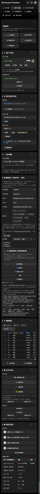
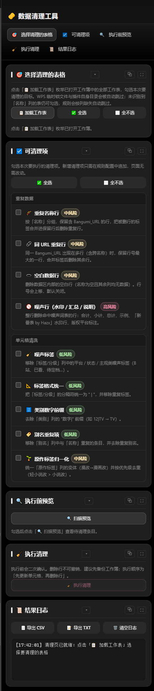

[](LICENSE)
[](https://www.typescriptlang.org/)
[](#sec-5)
[](https://github.com/awujiana)
[](#sec-13)

[](https://github.com/awujiana/My-Bangumi-Database-for-WPS/releases)
[](https://github.com/awujiana/My-Bangumi-Database-for-WPS/stargazers)
[](https://github.com/awujiana/My-Bangumi-Database-for-WPS/issues)

<div align="center">

[](images/mbd-logo.svg)

<h1>我的 Bangumi 数据库 (WPS版)</h1>
<h2>My-Bangumi-Database-for-WPS</h2>

<strong>在 WPS 表格里管理 Bangumi 番组数据：上传同步、数据同步、收藏下载、新番表富化与数据清洗</strong>

</div>

> [!WARNING]
> 本项目的相当一部分代码由 AI 辅助生成，并经过持续的人工作业、联调和重构，但它仍然可能存在遗漏、边界情况处理不足或行为与预期不完全一致的问题。如果你在使用过程中发现 Bug、兼容性问题、异常行为或文档缺失，欢迎积极提交 Issue。最好附上复现步骤、日志、截图和系统版本信息，这会非常有帮助。

## 📚 目录

- [项目简介](#sec-1)
- [核心特色](#sec-2)
- [无障碍与设计基线](#sec-2a)
- [界面预览](#sec-2b)
- [技术栈](#sec-3)
- [目录结构](#sec-4)
- [环境要求](#sec-5)
- [安装到 WPS 使用环境](#sec-5b)
- [更新到新版本](#sec-5c)
- [开发调试](#sec-6)
- [构建与打包](#sec-7)
- [配置备份与更新安全](#sec-7b)
- [使用示例](#sec-8)
- [测试](#sec-9)
- [代码规范与贡献](#sec-10)
- [文档索引](#sec-11)
- [数据来源](#sec-12)
- [反馈建议](#sec-13)
- [参考与致谢](#sec-13b)
- [赞赏支持](#sec-13c)
- [开源协议](#sec-14)

<a id="sec-1"></a>

## 🚀 项目简介

**My Bangumi Database for WPS** 是一个运行在 **WPS Office** 中的表格加载项，用于在本地表格与 [Bangumi 番组计划](https://bgm.tv/) 之间双向搬运数据：

- **上传同步**：把表格里的观看状态 / 评分 / 标签批量写回 Bangumi；
- **数据同步**：从公开数据仓库拉取 Bangumi 资料，按 SID 增量写入表格；
- **收藏下载**：把 Bangumi 收藏列表标记到表格；
- **新番表富化 / 数据清洗 / 番剧高亮 / 条件格式管理**：把追番表整理成可长期维护的样子。

数据源由姊妹仓库 [Bangumi-Archive-Anime-Excel](https://github.com/awujiana/Bangumi-Archive-Anime-Excel) 每周从 Bangumi 官方 Archive 处理后下发，插件免 Token 即可同步。

> [!IMPORTANT]
> **网络说明：`https://bgm.tv/` 在中国大陆无法直连。** 上传同步、收藏下载、Token 校验等直接访问 Bangumi 的功能需要自备代理 / 加速工具，并让 WPS 的网络请求走该代理；请自行解决网络环境问题。若只想离线整理数据，可使用「数据同步」（从 GitHub / GitLab / Gitee / Gist / 本地文件拉取 Archive 数据），该路径不依赖 bgm.tv。

---

<a id="sec-2"></a>

## ✨ 核心特色

| 能力                 | 说明                                                                                                                                                                                                                                                                                                                                                                                                                                                                                                                                                                                                                                                                                                                                                                                                                                                                                                                                                                                                                                                                      |
| -------------------- | ------------------------------------------------------------------------------------------------------------------------------------------------------------------------------------------------------------------------------------------------------------------------------------------------------------------------------------------------------------------------------------------------------------------------------------------------------------------------------------------------------------------------------------------------------------------------------------------------------------------------------------------------------------------------------------------------------------------------------------------------------------------------------------------------------------------------------------------------------------------------------------------------------------------------------------------------------------------------------------------------------------------------------------------------------------------------- |
| 📤 **上传同步**      | 将表格中的观看状态、评分、标签批量同步到 Bangumi API（指数退避重试 + 请求竞态防护）。                                                                                                                                                                                                                                                                                                                                                                                                                                                                                                                                                                                                                                                                                                                                                                                                                                                                                                                                                                                     |
| 📥 **数据同步**      | 从远程仓库（GitHub / GitLab / Gitee / Gist / 本地文件）下载 Bangumi 资料 JSONL 并增量写入表格，内置 24h 本地缓存与 DJB2 哈希比对。                                                                                                                                                                                                                                                                                                                                                                                                                                                                                                                                                                                                                                                                                                                                                                                                                                                                                                                                        |
| ↩️ **收藏下载**      | 从 Bangumi 拉取收藏列表标记到表格；工作表为空时可自动填充为 Bangumi 账号收藏条目，再标记到表格。                                                                                                                                                                                                                                                                                                                                                                                                                                                                                                                                                                                                                                                                                                                                                                                                                                                                                                                                                                          |
| 🔄 **5 种同步策略**  | `add-update` / `add-only` / `update-only` / `mirror` / `force-overwrite`。                                                                                                                                                                                                                                                                                                                                                                                                                                                                                                                                                                                                                                                                                                                                                                                                                                                                                                                                                                                                |
| ✅ **同步偏好**      | 增量同步、冲突跳过、同步记录开关、默认收藏列表类型、默认时间筛选范围、自动刷新间隔；基于同步记录的「撤销同步」。                                                                                                                                                                                                                                                                                                                                                                                                                                                                                                                                                                                                                                                                                                                                                                                                                                                                                                                                                          |
| 🎨 **外观主题**      | 深色 / 浅色 / 跟随系统 / 定时四种模式；设置页日夜开关（太阳 / 月亮滑块）点一下即从按钮中心向外扩散切换，可设深浅起止时间。                                                                                                                                                                                                                                                                                                                                                                                                                                                                                                                                                                                                                                                                                                                                                                                                                                                                                                                                                |
| ⌨️ **快捷键**        | 六个面板跳转可自定义键盘组合（录制式改绑、重复组合拒绝保存并指出占用者）；侧栏导航支持中键 / Ctrl+左键手势（专注 / 隐藏）。                                                                                                                                                                                                                                                                                                                                                                                                                                                                                                                                                                                                                                                                                                                                                                                                                                                                                                                                               |
| 🧩 **模块排序**      | 每页模块可拖拽或 ↑↓ 排序；眼睛按钮可逐模块隐藏，也能一键隐藏整条侧栏功能导航（窄任务窗格时主区铺满）。                                                                                                                                                                                                                                                                                                                                                                                                                                                                                                                                                                                                                                                                                                                                                                                                                                                                                                                                                                    |
| 🎛️ **条件格式口径**  | **「应用条件格式」默认增量**：只把「我的规则 / 默认规则集」写进表，表上已有同「范围 + 公式」的只刷新颜色、缺的补上，**既有规则一条都不删**（手工建的、别的工具建的都留着）；只有本插件上一轮写过、规则库里已删掉的才会被移除（账本 `conditionalFormat.applied.v1` 按表记录）。真要重来用 `🧹 清空整表后应用`（危险按钮，先列清单再确认）。写后逐条回读，没落地的规则名会直接出现在提示里。「工作表规则」的「自动聚类」可按公式 / 范围+公式 / 列 / 行分组；「🔗 合并重复项」把同公式同列的多条单行规则合并（仅连续行 / 强行并成一块两种口径），均在设置页切换。工作表规则每行可 ✎ 编辑（范围 / 公式 / 颜色）与 ⧉ 复制；「导出规则」支持导出到文件 / 剪贴板；「我的规则」可 ⧉ 复制所选后一次粘贴多条（表格展示、可批量统一范围），三处都能「✎ 批量修改」范围 / 公式 / 颜色；「导入工作表规则」右侧 ▾ 还能从文件（项目导出的 .json）或文本导入；目标工作表选择器按数量自动切换单选 / 搜索。四张表（工作表规则 / 我的规则 / 导入弹框 / 粘贴表格）都能**拖表头改列宽、拖表头下沿改行高**（双击把手回到自动），尺寸按表记住；默认是随窗格宽度自适应的模板，没拖过的列不会变死。 |
| 📌 **锚定 / 固定**   | 组标题「📌」= 锚定整列：把该组规则的应用范围改写成 `$J:$J`（多列 `$J:$L`），**公式不变**，之后增删行不再影响它；「📎 固定单元格」= 钉到单个 `$J$5`，删行删列后仍只作用于该单元格，改动后按「🔧 恢复锚定」一键修回。记录随配置导出备份。                                                                                                                                                                                                                                                                                                                                                                                                                                                                                                                                                                                                                                                                                                                                                                                                                                   |
| 🗓️ **季度/年度筛选** | 高亮页支持「全部 / 年度 / 季度 / 月份 / 未来番」筛选，与 GitHub 同步筛选同口径；「筛选显示」直接隐藏表格中不命中的行。                                                                                                                                                                                                                                                                                                                                                                                                                                                                                                                                                                                                                                                                                                                                                                                                                                                                                                                                                    |
| 🪄 **新番表富化**    | 自动补全新番表的名称 / 别名差异，映射 infobox 字段，减少手工录入。                                                                                                                                                                                                                                                                                                                                                                                                                                                                                                                                                                                                                                                                                                                                                                                                                                                                                                                                                                                                        |
| 🔑 **Token 管理**    | 设置、测试、复制、清除 Bangumi API Token。                                                                                                                                                                                                                                                                                                                                                                                                                                                                                                                                                                                                                                                                                                                                                                                                                                                                                                                                                                                                                                |
| 🆕 **检查更新**      | 从 GitHub Release 检查新版本，弹窗显示版本与更新说明，带下载进度与可复制日志；**一键自动安装**：确认后 WPS 自动关闭 → 覆盖加载项目录 → 自动重新打开（装前整份备份、失败回滚，有未保存文档时拒绝安装）。                                                                                                                                                                                                                                                                                                                                                                                                                                                                                                                                                                                                                                                                                                                                                                                                                                                                   |
| 💙 **赞赏页**        | 功能区「赞赏」按钮打开赞赏页，含作者 GitHub、邮箱、粉丝 QQ 群与微信赞赏码。                                                                                                                                                                                                                                                                                                                                                                                                                                                                                                                                                                                                                                                                                                                                                                                                                                                                                                                                                                                               |
| ⚙️ **双面板 UI**     | 主面板 + 设置面板动态停靠协调；设置面板侧边功能导航（支持仅图标 + 悬停提示）；基于 `data-action` 的统一事件分发（30+ action）。                                                                                                                                                                                                                                                                                                                                                                                                                                                                                                                                                                                                                                                                                                                                                                                                                                                                                                                                           |

---

<a id="sec-2a"></a>

## ♿ 无障碍与设计基线

界面按 [WCAG 2.2 AA](https://www.w3.org/TR/WCAG22/) 与「十大可用性原则 + Refactoring UI 七视角」落地。深浅两套主题共用一套 token（`css/tokens.css`），颜色不写死在组件里。

**自动走查口径**（真浏览器 headless Chrome；7 个页面 × 深 / 浅双主题 × 320 / 375 / 768 / 1280 四个视口）：

| 检查项             | 基线                               | 实测       |
| ------------------ | ---------------------------------- | ---------- |
| 正文文字对比度     | ≥ 4.5:1（大字 ≥ 3:1）              | 0 处不达标 |
| 指针目标尺寸       | ≥ 24×24 CSS px（正文内联链接除外） | 0 处不达标 |
| 整页横向溢出       | 无                                 | 0 处       |
| 图标按钮可访问名称 | 全部有 `title` / `aria-label`      | 0 处缺失   |

> 这是自动扫描结果，**不等于**合规认证：键盘走查、真实辅助技术（NVDA / 讲述人）与真实用户测试仍需人工进行。

**几条硬约定**（改样式时别踩）：

- **填充色与文字色分开**：`--danger` / `--success` / `--accent-blue` 是**填充色**（铺底、描边、承载白字）；当文字用必须换成 `--text-danger` / `--text-success` / `--text-link`。同一个色值在浅色主题上当文字必然失守（`#2f7fe0` 在 `#eef0f3` 上只有 3.51:1）。
- **弱化文字 `--text-3` 已按最深 / 最浅底色验算**：深色 `#a0a0a0`（最差 4.69:1）、浅色 `#5f646c`（最差 4.72:1）。再调浅 / 调深就会跌破 4.5。
- **渐变背景的对比度按每个色标算**，不能只看 `background-color`——渐变元素的 `backgroundColor` 是透明的，只回溯父级会把「浅底深字」误判成「深底深字」。
- **窄任务窗格（320px）单列**是硬要求，不允许靠缩小字号或点击区塞下桌面布局。

---

<a id="sec-2b"></a>

## 🖼️ 界面预览

<p align="center">
  
  
</p>

> 截图取自实际插件界面（深色主题）；不同 WPS 版本与窗口宽度下，面板会自动切换为单列 / 双列布局。

---

<a id="sec-3"></a>

## 🧰 技术栈

- **语言**：TypeScript（strict 模式，ES2022 目标）
- **构建**：Vite 6（打包 `dist/`）+ `tsc`（编译 `dist-ts/`）
- **运行环境**：WPS Office JSAPI（ET 加载项），通过 `wpsjs` CLI 调试
- **代码质量**：ESLint 8（含 `@typescript-eslint/strict-type-checked` 类型检查档，全量 0 error）+ Prettier 3 + Husky + lint-staged
- **测试**：Vitest 4（含 `@vitest/coverage-v8`）
- **运行时依赖**：`zod`（数据校验）、`dompurify`（HTML 净化）
- **构建期依赖**：`@napi-rs/canvas` / `@resvg/resvg-js`（图像导出）

---

<a id="sec-4"></a>

## 📂 目录结构

以下为发布包 **`My-Bangumi-Database-for-WPS-v2.3.0.zip`** 解压后的目录结构（即使用者安装到 WPS 后实际加载的文件，不含源码 / 测试 / 文档）：

```
My-Bangumi-Database-for-WPS-v2.3.0/
├── index.html                  # 加载项入口（WPS 启动时加载）
├── main.js                     # 动态模块加载器（Ribbon 早期占位 + 模块就绪后替换真实实现）
├── manifest.xml                # 加载项清单（ApiVersion / Name）
├── ribbon.xml                  # 功能区按钮配置（「Bangumi同步」Tab）
├── wpsjsrpcsdk.js              # WPS JSAPI RPC SDK
├── assets/                     # Vite 哈希资源
│   ├── main.<hash>.js          # 主入口打包产物
│   ├── logger.<hash>.js        # 日志模块
│   └── data-export.<hash>.js   # 数据导出模块
├── css/                        # 全局与各页面样式
│   ├── tokens.css              # 设计变量（颜色 / 间距 / 字号）
│   ├── styles.css              # 通用组件与 Toast
│   ├── panel-theme.css         # 面板主题与顶栏
│   ├── clean.css
│   ├── conditional-format.css
│   ├── context-menu.css
│   ├── detachable-panel.css
│   ├── diff.css
│   ├── donate.css
│   ├── enrich.css
│   ├── highlight.css
│   ├── sortable-list.css
│   └── update-dialog.css
├── dist-ts/                    # tsc 编译产物（运行时依赖）
│   ├── index.js
│   ├── ribbon.js
│   ├── core/                   # 常量、错误处理、结果、进度、类型
│   ├── entry/                  # ribbon / panel / settings 入口
│   ├── panel/                  # 主面板、设置、清洗、富化、高亮、条件格式、赞赏页逻辑
│   ├── schemas/                # zod 校验 schema
│   ├── services/               # 配置 / Ribbon 服务
│   ├── sync/                   # 同步引擎（github / gitlab / gitee / gist / 本地文件 / Archive）
│   ├── tools/                  # 工具函数（http / wps / logger / sanitize / clipboard ...）
│   └── ui/                     # 面板 UI 与 handlers/
├── images/                     # 功能区与面板图标（SVG）、赞赏二维码
├── libs/                       # 运行时第三方库
│   ├── fit-viewport.js
│   ├── purify.js               # DOMPurify UMD
│   ├── purify.min.js.map
│   └── wps-sdk-loader.js
└── ui/                         # 面板 HTML
    ├── panel.html              # 主面板
    ├── settings.html           # 设置面板
    ├── clean.html              # 数据清洗
    ├── conditional-format.html # 条件格式管理
    ├── donate.html             # 赞赏页
    ├── enrich.html             # 新番表富化
    └── highlight.html          # 番剧高亮
```

> 上述结构是 **`publish` 分支 / 发布 zip** 的内容。默认分支 **`main`** 是完整源码工作区，在上面之外还含 `tests/`、`scripts/`、`package.json` 与 `tsconfig*` / `vite.config`，`git clone` 后 `npm install` 即可跑 `npm run gate` / `npm run build`。

<details>
<summary>📂 ts/ 源码结构（供查阅）</summary>

```
ts/
├── core/        # 常量、类型、结果、错误处理、UI 桥接
├── entry/       # ribbon / panel / settings 入口
├── panel/       # 主面板、设置、清洗、富化、高亮、条件格式、赞赏页逻辑
├── schemas/     # zod 校验 schema
├── services/    # 配置 / Ribbon 服务
├── sync/        # 同步引擎（github / gitlab / gitee / gist / 本地文件 / Archive）
├── tools/       # 工具函数（http / wps / logger / sanitize / clipboard / theme ...）
├── ui/          # DOM 组件、对话框、handlers（data-action 分发）
├── index.ts
└── ribbon.ts
```

</details>

---

<a id="sec-5"></a>

## 🔧 环境要求

| 依赖       | 版本                    | 说明                                       |
| ---------- | ----------------------- | ------------------------------------------ |
| WPS Office | 2019+（Windows）        | 需支持 JSAPI / 加载项调试（`wpsjs debug`） |
| Node.js    | 18+（推荐 LTS 20 / 22） | 构建与调试工具链                           |
| npm        | 随 Node 安装            | 包管理                                     |
| Git        | 较新版本                | 版本控制                                   |

---

## 📥 开发者环境搭建（仅开发需要）

> 这是**开发插件本身**的步骤，需在默认分支 `main` 上执行（`publish` 分支只有发布文件，缺 `package.json` 与构建配置，在那里 `npm install` 会失败）。普通使用者安装插件请看下一节 [安装到 WPS 使用环境](#sec-5b)，无需 Node / 构建。

```bash
# 1. 克隆仓库
git clone https://github.com/awujiana/My-Bangumi-Database-for-WPS.git
cd My-Bangumi-Database-for-WPS

# 2. 安装依赖
npm install
```

> `wpsjs`、`vite` 等 CLI 已作为 devDependencies 随 `npm install` 安装，无需全局安装。

---

<a id="sec-5b"></a>

## 📦 安装到 WPS 使用环境

插件是 WPS 表格（ET）加载项。部署遵循 WPS 官方「publish.xml 模式」（推荐）与「jsplugins.xml 模式」，最终用户拿到的是**构建产物**，无需 Node / 构建环境。

### 方式一：开发者调试安装（仅开发时）

```bash
npm run debug
```

`wpsjs debug` 会编译 TypeScript、启动调试服务器（默认端口 `3889`），并自动在 WPS 中注册一个调试加载项；启动 WPS 表格后即可在「Bangumi同步」选项卡看到按钮。详见 [开发调试](#sec-6)。

### 方式二：使用者安装（正式环境，离线 / 本地）

1. **获取加载项包**
   - 开发者：见 [构建与打包](#sec-7)，`npm run build` 产出的 `dist/` 目录（含 `index.html` / `manifest.xml` / `ribbon.xml` / `images/` / `ui/` / `dist-ts/` / `css/` / `libs/` / `assets/`）就是完整加载项包。
   - 使用者：直接从 [GitHub Releases](https://github.com/awujiana/My-Bangumi-Database-for-WPS/releases) 下载发布的 `My-Bangumi-Database-for-WPS-vX.Y.Z.zip`，解压得到加载项目录。

2. **注册到 WPS**

   WPS 各系统读取加载项清单的目录：

   | 系统        | 加载项目录                                                                    |
   | ----------- | ----------------------------------------------------------------------------- |
   | **Windows** | `%APPDATA%\kingsoft\wps\jsaddons`                                             |
   | **macOS**   | `~/Library/Containers/com.kingsoft.wpsoffice.mac/Data/.kingsoft/wps/jsaddons` |
   | **Linux**   | `~/.local/share/Kingsoft/wps/jsaddons`                                        |

   > Windows 上最快的到达方式：`Win + R` → 输入 `%appdata%` → 回车，再依次进入 `kingsoft\wps\jsaddons`。
   > 例：`C:\Users\Administrator\AppData\Roaming\kingsoft\wps\jsaddons`
   - **(推荐) 安装器 / publish.html**：用 WPS 官方 `wpsjs` 工具链生成的 `publish.html`（离线模式）或 `wpsjs build --exe` 生成的安装器，浏览器打开后点「安装」，会自动写入上面的 `publish.xml`。
   - **手动注册**：把解压后的加载项目录放到 `%appdata%\kingsoft\wps\jsaddons\My Bangumi Database for WPS_2.1.0\`，并编辑同目录的 `publish.xml`（不存在则新建），加入一条加载项：

     ```xml
     <?xml version="1.0" encoding="UTF-8" standalone="yes"?>
     <jsplugins>
       <jsplugin name="My Bangumi Database for WPS"
                 url="file:///C:/Users/你/jsaddons/My Bangumi Database for WPS_2.1.0/"
                 enable="true"/>
     </jsplugins>
     ```

     > `url` 指向**包含 `index.html` 的目录**，可用 `file:///` 本地路径或 `http(s)://` 服务器地址；多个加载项在同一 `publish.xml` 中各写一条 `<jsplugin>` 即可。

3. **卸载**

   **操作前请务必先完全关闭 WPS**（含托盘里的 WPS 云服务进程），否则文件被占用会删不掉：

   1. 进入上表的加载项目录（Windows：`%APPDATA%\kingsoft\wps\jsaddons`）；
   2. 找到本插件的文件夹 —— 名为 `My-Bangumi-Database-for-WPS_2.1.0`（或 `my-bangumi-database-for-wps_2.1.0`、以及带版本号后缀的类似名称），**整目录删除**；
   3. 可选：编辑同目录的 `publish.xml`，删掉指向该目录的 `<jsplugin .../>` 那一行（只删这一行）。

   > ⚠️ 不要删除整个 `jsaddons` 文件夹，也不要删掉 `publish.xml` 本身 —— 里面可能还有其它加载项的注册信息，删了会一起失效。
   > 卸载只移除插件文件，**表格里的数据与 `%APPDATA%` 下其它 WPS 配置不受影响**；插件配置（Token、偏好）随 `PluginStorage` 保存在文档与宿主侧，重装后通常仍在。

4. **启用**：关闭并重新打开 WPS 表格。首次出现「Bangumi同步」选项卡时会请求允许，允许后约半分钟加载完成（可在 WPS「应用中心 / 加载项」里管理启用 / 禁用）。

### 方式三：在线部署（局域网 / 服务器）

将 `dist/` 部署到 Web 服务器（需 `https://` 或完整 `http://` 地址，例如 `https://example.com/bgm/`），再用 `wpsjs publish`（或手工生成 `publish.html`）把安装页分发给使用者；使用者在浏览器打开 `publish.html`、状态显示「正常」后点「安装」即可。`wpsjs publish` 会把 `wps-addon-build/` 部署到服务器，并把 `wps-addon-publish/publish.html` 作为安装入口。

> `npm run debug` 仅用于开发联调；正式给使用者的是方式二 / 方式三的构建产物，对方无需安装 Node。

---

<a id="sec-5c"></a>

## 🔄 更新到新版本

装好之后不必再手动找包覆盖：设置页底部有「检查更新」，走完流程即可。

### 方式一：一键自动安装（Windows，推荐）

设置页 → 滚到底部「关于」→ 点 **检查更新** → 发现新版后点 **⬇️ 下载并安装**。

弹窗里会先告诉你「点下去会发生什么」，确认后依次自动完成：

1. **下载**更新包（带进度条，每 10% 记一行日志）；
2. **校验 SHA-256**：与发布清单 `download/version.json` 里的哈希比对，
   不一致**直接拒绝安装**（连安装脚本都不会生成）；
3. **关闭 WPS**（3 秒后请求退出，留时间让你看完日志）；
4. 安装程序等 WPS 退出（最多 180 秒）→ **整份备份**加载项目录 → 覆盖解压 →
   **自动重新打开 WPS**。解压失败会用备份回滚，插件仍是旧版可用状态。

安全边界（这几条是刻意设计的，不是「信任作者」）：

- 安装脚本由插件**内置常量生成**，全程不下载任何脚本；脚本里也**不联网**，
  更新包只能来自插件自己下载并校验过的那份字节，脚本还原后还会再复核一次哈希与 zip 魔数；
- 脚本与更新包放在**每次新建的随机临时目录**（`%TEMP%\bgm-update-<16 位随机>\`），
  不复用可预测文件名；
- **只替换程序文件**。设置、Token、账号、条件格式规则存在 WPS 的插件存储里，
  不在安装目录中，不会被覆盖；
- 检测到**未保存的文档**会直接拒绝安装（避免关 WPS 时把工作丢掉）；
- 安装日志：`%TEMP%\bgm-update-<版本>.log`（失败时弹窗里也会给出路径）。

### 方式二：手动安装（macOS / Linux，或自动安装不可用时）

自动安装依赖 PowerShell，**仅 Windows 可用**。其他情况：

1. 设置页 → 检查更新 → 下载并安装；若自动安装不可用，更新包会存到浏览器下载目录
   （日志里会写明文件名）；
2. **完全关闭 WPS**；
3. 解压更新包，把里面的内容覆盖到加载项目录
   （`%APPDATA%\kingsoft\wps\jsaddons\My-Bangumi-Database-for-WPS_<版本>\`，
   macOS / Linux 见[安装](#sec-5b)里的路径表）；
4. 重新打开 WPS。

> 手动安装不会动你的设置与数据——它们不在加载项目录里。
> 覆盖前建议先把整个加载项目录复制一份备份。

### 校验发布包（可选，想自己核一遍时）

`download/version.json` 里带 `sha256` 与 `size`：

```bash
# Windows PowerShell
Get-FileHash .\My-Bangumi-Database-for-WPS-v2.2.4.zip -Algorithm SHA256
# macOS / Linux
shasum -a 256 My-Bangumi-Database-for-WPS-v2.2.4.zip
```

两个值一致才说明这份包没被改过。

---

<a id="sec-6"></a>

## 🐞 开发调试

> 以下命令仅适用于维护者的完整源码工作区；本仓库只提供 `ts/` 源码，不提供构建脚本与依赖配置。

加载项通过 WPS 的 `wpsjs debug` 启动调试会话（会编译 TS 并拉起 WPS 加载项）：

```bash
# 推荐：一键调试（先 tsc 编译，再 watch + 启动 WPS 调试）
npm run debug
```

`npm run debug` 等价于：

```bash
npm run build:ts                 # tsc --project tsconfig.build.json → dist-ts/
# 并行：tsc --watch 监听改动 + wpsjs debug 拉起 WPS
```

- **调试入口**：WPS 启动时加载 `index.html`，`main.js` 完成 Ribbon 早期占位；TypeScript 模块就绪后由 `ts/ribbon.ts` 通过 `window._bgmRibbonReady` 替换真实实现并 `Invalidate` 刷新图标。
- 若仅需 Vite 开发服务器（`npm run dev`，端口 `5173`）：**生产构建与 WPS 加载仍使用 `npm run debug` / `npm run build`**，Vite dev server 仅用于前端资源调试，不代表最终加载行为。`dev` 端口已与 wpsjs 调试端口（`3889`）错开，避免冲突。

---

<a id="sec-7"></a>

## 📦 构建与打包

```bash
# 完整构建：tsc → dist-ts/ ，再 Vite 打包 → dist/
npm run build

# 仅编译 TypeScript（不打包）
npm run build:ts
```

**构建产物**：

- `dist-ts/`：`tsc` 编译后的 JS（被 `main.js` / `panel.html` 运行时依赖）。
- `dist/`：`vite build` 输出，含 `manifest.xml`、`ribbon.xml`、`images/`、`ui/`、`main.js`、`dist-ts/**`、`css/` 与经哈希的 `assets/`。将此目录作为加载项发布包部署到 WPS。

#### 打包发布到 Releases（离线分发）

WPS 官方 `wpsjs` 工具包提供 `wpsjs build` 生成离线安装包（输出 `wps-addon-build/`，加 `--exe` 可生成 Windows 安装器），用于离线分发。本仓库的加载项由 Vite 构建，**等价的可分发目录是 `npm run build` 产出的 `dist/`**——把 `dist/` 压缩即可作为离线包上传 Releases：

```bash
# 1. 构建完整加载项包（产物在 dist/）
npm run build

# 2. 压缩为发布包（版本号取自 package.json 的 version）
VERSION=$(node -p "require('./package.json').version")
zip -r "My-Bangumi-Database-for-WPS-v${VERSION}.zip" dist
```

将 `My-Bangumi-Database-for-WPS-vX.Y.Z.zip` 上传到 [GitHub Releases](https://github.com/awujiana/My-Bangumi-Database-for-WPS/releases)，使用者按 [安装到 WPS 使用环境](#sec-5b) 的「方式二」下载解压、注册即可，无需 Node 与构建。

> 若沿用 WPS 标准 `wpsjs` 工程布局，也可直接 `wpsjs build`（生成 `wps-addon-build/` + `wps-addon-publish/publish.html`）后将该产物压缩上传；两种产物在计算机上都是「含 `index.html` 的目录」，安装方式一致。

**Windows 安装器的图标**：`wpsjs build --exe` 产出的是 wpsjs 默认图标。仓库内置了自动化：

```bash
npm run icon                      # 用 images/app-icon.ico 换图标 → release/<版本>.exe
npm run icon -- --icon D:/x.ico   # 换一个 ico
npm run icon:merge                # images/ 里的多个单尺寸 ico → 合成 images/app-icon.ico
```

脚本走 Resource Hacker 命令行（`-action addoverwrite -mask ICONGROUP,MAINICON,`），换完会校验「除 `.rsrc` 外所有节逐字节相同」+「ico 里每张图都进了 exe」，任一不过就删产物并报错。

图标本身想用多尺寸：**已经是一个多尺寸 ico** 就直接覆盖 `images/app-icon.ico`，不用改代码；手里是「16.ico / 32.ico / 48.ico …」一堆**单尺寸文件**时，全丢进 `images/`（或任意目录）再跑 `npm run icon:merge -- --merge-dir <目录>`，脚本按尺寸升序合成、同尺寸只留数据更大的一张、写完回读逐张比对。当前 `images/app-icon.ico` 就是 16/24/32/48/64/128/256 七张合成的（10,977 B）。

**插件品牌图标**：`images/mbd-logo.svg`（#1296db 配色、含 MBD 字样），随 `dist/`（或 `wpsjs build` 产物）一并打包进加载项，同时作为 README 标题标识与 Releases 资源使用。

### 维护者：两棵工作树 + 发布流程

本机维护时存在**两棵内容一致、职责不同**的树（不要在两棵树里各改一半）：

| 树                             | 位置（本机）                                  | 职责                                                                                              |
| ------------------------------ | --------------------------------------------- | ------------------------------------------------------------------------------------------------- |
| **开发树**                     | `Excel加载项/BGM/restore-src`                 | 含 `tests/`、`scripts/`、`package.json` / `tsconfig*` / `vite.config`，跑 `npm run gate` 全量门禁 |
| **发布树**（= 本 GitHub 仓库） | `Excel加载项/BGM/My-Bangumi-Database-for-WPS` | 只放发布文件 + `ts/` 源码 + `dist-ts/`；远端 `origin` 指向 GitHub                                 |

标准流程：

1. 在**开发树**改代码 → `npm run gate` 全绿（lint / 类型 / 门禁脚本 / 全量单测）；
2. 把改动的文件同步到**发布树**（`ts/`、`ui/`、`css/`、`images/` 等；`tests/` 不进发布树）；
3. 在发布树 `npm run build:ts` 重新生成 `dist-ts/`；
4. 提交后运行 `node ../publish.mjs`（或双击 `publish.cmd`）—— 脚本会重建只含发布文件的 `publish` 分支并强推 `origin/main`，本地 `main` 保留工具链。

> ⚠️ 新增的 `dist-ts/**` 文件被 `.gitignore` 挡住，`publish.mjs` 的 `git add -A` 收不到，必须显式 `git add -f dist-ts/...`，否则发布包缺模块会直接白屏。
> ⚠️ 开发树缺 `node_modules` 时，用目录联接复用发布树的依赖（`New-Item -ItemType Junction`），不必重新 `npm install`。

---

<a id="sec-7b"></a>

## 💾 配置备份与更新安全

设置页 → **配置管理** 提供一键备份与恢复：

| 按钮            | 作用                                                                     |
| --------------- | ------------------------------------------------------------------------ |
| 💾 保存所有配置 | 把当前设置页各表单的值写回存储。                                         |
| 📤 导出配置     | 下载 `bgm-config-YYYY-MM-DD.json` 并复制到剪贴板（一份文件即全量备份）。 |
| 📥 导入配置     | 粘贴该文件 JSON 恢复；导入后自动套用日志级别并刷新账号 / GitHub 表单。   |
| ♻️ 重置全部配置 | 清空所有已保存配置（谨慎，建议先导出）。                                 |

**导出范围**：Bangumi Token 与多账号列表（含用户资料、过期时间）、GitHub 仓库配置（含同步源类型、Gist ID、分片选择、同步策略）、外观（主题 / 定时切换 / 模态框按钮位置）、导航（图标模式 / 分块排序 / 折叠隐藏）、快捷键绑定、同步偏好、默认导入导出路径、日志级别、富化（预览设置 / 自动探测）、番剧高亮（列映射 / 模式 / 筛选范围 / 非动漫）、条件格式（**规则库 / 已应用规则账本 / 目标工作表 / 聚类与合并口径 / 分组命名 / 锚定与固定记录**）、数据清理的规则开关。

**刻意不导出**：会话态与缓存 —— 各页锁定的工作表实例 `bgm_locked_sheet_*`、面板显示信号 `bgm_panel_shown_at`、COM 卡顿观测 `bgm_com_stall_*`、数据上下文 `bgm_data_context`、目标探测缓存 `bgm_target_detect_cache`；以及按工作簿记住的清理勾选 `bgm_clean_sheets:`（键里是本机文件绝对路径，换机器对不上，到新机器重新勾选即可）。

**更新会不会丢配置**（结论：**正常更新不会丢**）：

- 全部配置存在 WPS 的 **PluginStorage**（按加载项 ID 存放，独立于加载项文件）。更新 = 替换加载项目录 / 覆盖 `dist`，**不会**触碰 PluginStorage —— 规则库、锚定与固定记录、账号、主题与快捷键等全部原样保留。
- 会丢的只剩三种情况：**卸载加载项**、**清理 WPS 缓存 / 用户数据**、**换机器**。这三种场景用上面的导出 / 导入兜底（导入不需要重新构建，粘贴 JSON 即可）。
- 运行记录（同步记录、系统日志、富化记录、清理日志）另在设置页「数据导出」导出为 CSV / TXT，不属于配置备份范围。
- 反过来，插件自身**不会**在启动时清除用户配置：不存在「升级即重置」的逻辑，重置只由用户手动点「♻️ 重置全部配置」触发。

---

<a id="sec-8"></a>

## 📖 使用示例

### 1. 设置 Bangumi Token

1. 在 Bangumi 个人设置中获取 **API Token**。
2. 点击功能区 **设置Token**（或主面板 Token 区「设置」），粘贴 Token。
3. 点击 **测试Token** 验证有效性，再点 **保存**。

### 2. 上传同步（Excel → Bangumi）

1. 在 Excel 中准备好追踪表（含「名称 / 是否看完 / 打分 / 标签分级」等列）。
2. 打开 **同步面板**，在「数据选择区」选择目标工作簿与工作表（支持自动 / 手动选择模式）。
3. 点击 **上传同步**（整表）或 **选中行同步**（仅选中范围）。
4. 实时进度条显示成功 / 失败 / 跳过计数；完成后写入同步记录并 Toast 总结。

### 3. 数据同步（远程仓库 → Excel）

1. 打开 **设置面板** →「远程仓库配置」，填写：

   | 配置项 | 值                            |
   | ------ | ----------------------------- |
   | 同步源 | GitHub                        |
   | owner  | `awujiana`                    |
   | repo   | `Bangumi-Archive-Anime-Excel` |
   | branch | `main`                        |
   | path   | `data/bangumi.jsonlines.gz`   |

2. 选择同步策略（`add-update` 默认，保守）。
3. 点击 **立即同步**（或功能区 **数据同步**）。插件下载 JSONL → 哈希比对缓存 → 按 SID 增量写入 Excel。
4. 可用 **撤销同步** 回滚上一次操作；**清缓存** 强制重新下载。

> 数据源格式、清单字段与选片规则见[数据仓库 README](https://github.com/awujiana/Bangumi-Archive-Anime-Excel)。

### 4. 新番表富化

点击功能区 **新番表富化**，对「新番表」执行字段自动补全（名称 / 别名差异补全、infobox 字段映射），减少手工录入。

### 5. 条件格式：锚定整列 / 整行 / 固定单元格

打开 **条件格式** 页 →「目标工作表的既有规则」区：

1. **锚定整列 / 整行**：组标题上有 **「列」「行」** 两个按钮。
   - **列**：应用范围改写成整列（`$J:$J`，多列 `$J:$L`），对「增删行」免疫；
   - **行**：应用范围改写成整行（`$5:$5`，多行 `$5:$8`），对「增删列」免疫。
     两者都**公式一个字不改**。
2. **固定单元格**：点 **📎 固定单元格**，输入目标地址（如 `J5`），把选中规则（未选则全部）钉成
   `$J$5` 单格范围。适合「就这一个单元格要标色」的场景：无论前后删了多少行列，它只认这个地址。
3. **恢复**：增删行列后点 **🔧 恢复锚定**，插件按锚定表把跑偏的范围改回锚定值（打开页面时也会自动修一次）。
4. **导出 / 备份**：**📤 导出规则 ▾** 可选「导出到文件」或「复制到剪贴板」（后者不用先选保存位置）。
   锚定 / 固定记录写在 PluginStorage 里，随「设置 → 配置管理 → 📤 导出配置」一起导出；换机器导入即可，
   **更新插件不会丢**（详见 [配置备份与更新安全](#sec-7b)）。
5. **行内操作**：规则行不再放一排小按钮，操作统一在**右键菜单**里（导入规则库 / 归入分组 /
   如果为真则停 / 上移 / 下移 / 删除），行宽留给「应用于 / 公式」。
6. **目标工作表**：工作簿 / 工作表选择器按选项数量自动切换形态 —— ≤2 个用单选按钮、>10 个带搜索框，
   中间数量用原生下拉（通用组件 `option-picker`）。

---

<a id="sec-9"></a>

## 🧪 测试

```bash
npm run gate             # 质量门禁（十三关，推荐；提交前必跑）
npm test                 # 运行全部单元测试（Vitest）
npm run test:watch       # 监视模式
npm run test:coverage    # 生成覆盖率报告
npm run check:guards-reverse   # 反向验证门禁自身（改了 check-*.mjs 后手工跑）
npm run check:shard-layout     # 布局回归门禁（改了 css/ 或分片区后手工跑，需本机 Chrome）
npm run audit:layout           # 全页面布局审计（改了 css/ 或页面结构后手工跑，需本机 Chrome）
```

`npm run gate` 依次执行：`lint:check` → `check:dompurify-version` → `check:module-manifest` →
`check:cycles` → `check:ribbon-buttons` → `check:nav-order` → `check:com-in-loop` → `check:detachable`
→ `check:csp` → `check:wpsjs-patch` → `check:boot-com` → `typecheck:tests` → `test`。

`npm run check:guards-reverse` **不在 `gate` 内**：门禁里有多道是**源码级断言**，而一条永远为真的
断言与有效断言外观完全相同 —— 都是绿的。该脚本为这 6 条各注入一个「已知违规」，确认它们真的会红，
**且失败输出里出现预期片段**（脚本崩了退出码同样非 0），最后逐字节还原。
**新增源码级断言时必须同时在它的 `CASES` 里补一个变异用例**，否则那条断言只是「看起来在守门」。

`npm run check:shard-layout` 同样**不在 `gate` 内**（依赖本机 Chrome / Edge）：十三道关都是源码断言或
单元测试，**没有一道能发现样式错位** —— CSS 没有类型系统，jsdom 也不做布局计算。这道门禁用
headless Chrome 渲染真实的分片区块，在 320 / 400 / 500px 三种布局宽度下量**真实计算样式**，
断言「每个分片标签的文字只占 1 行、标签高 ≤ 40px、复选框 ≤ 20px」。
改了 `css/**`、`panel.html` 的分片区块或分片文案之后跑一次。

`npm run audit:layout` 把同一套思路推广到**全部 5 个页面**：按「原生 checkbox/radio 渲染尺寸 > 20px」
「短文本（≤ 24 字）却占多行」「内容横向溢出」三条客观判据找错位，一次就抓到 3 处与分片**同源**的 bug
（详见 [`CHANGELOG.md`](CHANGELOG.md) 里对应的修复记录）。判据 2 是启发式，命中项需人工确认；
命令支持 `--json` / `--widths 360,500` / 指定单个页面。

当前基线：**5369 条测试 / 178 文件**。

> **真实宿主（WPS / Excel）手工验收**：单元测试覆盖不到「宿主 API 的真实行为 / 真实网络 / 跨 WebView 通信 / 真实大表性能」，
> 这部分只能真机逐项过：装上 WPS 后按「使用示例」一节把六条主流程走一遍，重点看长表格滚动、网络中断重试、多账号切换与更新安装。

---

<a id="sec-10"></a>

## 🤝 代码规范与贡献指南

完整的开发环境、分支模型、提交规范、质量门禁与 PR 清单请见 **[CONTRIBUTING.md](CONTRIBUTING.md)**。以下为速览。

### 分支与提交流程

1. 从 `main` 切出特性分支：`git checkout -b feat/xxx` 或 `fix/xxx`。
2. 开发，并确保通过 lint / format / test。
3. 使用 **Conventional Commits** 规范提交：

   ```
   <type>(<scope>): <subject>
   ```

   - `type`：`feat` / `fix` / `refactor` / `docs` / `test` / `chore` / `style` / `perf`
   - 示例：`feat(sync): 实现别名富化 - 新番表名称差异自动补全`、`fix: 修复状态泄漏 + 统一 Button 命名空间`

4. 提交至 `main`（或发起 PR，视团队流程）。

### 代码质量

- **ESLint**：`npm run lint:check`（检查）/ `npm run lint`（自动修复），规则见 `.eslintrc.cjs`。
- **Prettier**：`npm run format:check` / `npm run format`，配置见 `.prettierrc`。
- **Husky + lint-staged**：`prepare` 安装 Git hook，提交时自动对暂存文件执行 lint / format（配置见 `lint-staged.config.js`、`.husky/`）。
- **TypeScript**：`tsconfig.json` 开启 `strict`、`noUncheckedIndexedAccess`、`exactOptionalPropertyTypes` 等严格检查；新增代码需通过 `npm run build:ts` 类型检查。

### 架构约定

- **模块解耦 / 循环依赖治理**：避免 `ts/` 模块间的循环依赖（参见提交「循环依赖治理与模块解耦完成」）。
- **面板命名**：统一 `taskpane` → `panel` 命名，页面逻辑文件使用 `Page` 后缀（`ts/panel/`）。
- **事件分发**：UI 通过 `data-action` 属性 + 统一 `handleActionClick(action, event)` 路由（见 `ts/ui/handlers/`）。
- **持久化**：配置经 `PluginStorage` 存储（`bgm_token` / `github_config` / `bgm_incremental_sync` / `bgm_theme` / `bgm_list_type` / `bgm_time_filter` / `bgm_refresh_interval` / `bgm_nav_icons_only` 等键）。
- **数据校验**：外部数据经 `ts/schemas/` 下的 zod schema 校验，再写入 Excel。

### 扩展：新增同步源 / 字段映射

- **新增同步源**：在 `ts/sync/` 下实现 `SyncSource` 接口并注册到 `sync-source-registry.ts`。
- **字段映射**：权威来源是 Archive 项目的 `Archive/config/field_mappings.json`（infobox 字段名 → 标准列名），本仓库不保留副本；改动后在 `ts/schemas/` 补充对应 zod 校验。

---

<a id="sec-11"></a>

## 📚 文档索引

仓库内可直接读的文档：

| 文档                                 | 内容                                                               |
| ------------------------------------ | ------------------------------------------------------------------ |
| [`README.md`](README.md)             | 安装 / 更新 / 使用示例 / 构建打包 / 配置备份（本文）               |
| [`CONTRIBUTING.md`](CONTRIBUTING.md) | 开发流程、提交规范、质量门禁、**命名规范（不缩写）**               |
| [`AGENTS.md`](AGENTS.md)             | 给 AI agent 的项目约定与禁忌（核心不变量 / 技术禁令 / 改动前检查） |
| [`CHANGELOG.md`](CHANGELOG.md)       | 按版本累积的变更记录（含每处修复的成因与实测数据）                 |

> 测试与质量：运行 `npm run gate`（详见「测试」一节）；测试文件位于 `tests/`，不逐条索引。
> 架构说明与逐按钮的用户手册**不随仓库分发**，相关内容分散在本 README 的「目录结构」「使用示例」「配置备份与更新安全」三节。

---

<a id="sec-11b"></a>

## 🗺️ 后续计划（TODO）

| 事项                                  | 状态         | 说明                                                                                                                                                                                                                                                                                                                                                 |
| ------------------------------------- | ------------ | ---------------------------------------------------------------------------------------------------------------------------------------------------------------------------------------------------------------------------------------------------------------------------------------------------------------------------------------------------- |
| Ribbon 精简模式（`dynamicMenu` 下拉） | **暂不实现** | 把「测试 Token / 复制 Token / 设置用户 ID / 撤销同步 / 关闭所有页面」等低频按钮收进一个 `dynamicMenu` 下拉，减少功能区占位。**为什么先不做**：`dynamicMenu` 需要在 `ribbon.xml` 里声明 `getContent` 回调并返回 XML 片段，WPS 各版本对该回调的刷新时机不一致（改完要重开文档才生效），做出来容易变成「点了没反应」。等有稳定的 WPS 版本基线后再实现。 |
| Ribbon 按钮按设置隐藏                 | **不做**     | `getVisible` 在 WPS 的 JS 加载项里支持不稳定（隐藏后常需重开文档），会制造「设置里点了没反应」的新问题。替代方案同上（收进 `dynamicMenu`）。                                                                                                                                                                                                         |

> 想优先做哪一项，欢迎开 Issue 说明使用场景（附 WPS 版本号），排期会据此调整。

---

<a id="sec-12"></a>

## 🗂️ 数据来源

插件默认从公开仓库 [`awujiana/Bangumi-Archive-Anime-Excel`](https://github.com/awujiana/Bangumi-Archive-Anime-Excel) 读取 `data/anime.manifest.json`（分片清单），再按表头选择需要的分片（`anime.base.jsonlines.gz` 等）下载。数据来自 Bangumi 官方 Archive 每周 dump，经处理后按字段分片、gzip 压缩下发，插件端免 Token 即可同步。

> 分片格式、清单字段与选片规则见[数据仓库 README](https://github.com/awujiana/Bangumi-Archive-Anime-Excel)。

---

<a id="sec-13"></a>

## 💬 反馈建议

- **Bug / 功能建议**：请到 [Issues](https://github.com/awujiana/My-Bangumi-Database-for-WPS/issues) 提交，附上复现步骤、日志、截图与 WPS 版本。
- **粉丝 QQ 群**：**436212515** —— 用起来卡住了、想问某个站点怎么配、或者单纯催更，都可以在群里直接说，比 Issue 更快。
- **安全 / 数据问题**：请直接邮件联系作者，不要在公开 Issue 里贴 Token 或表格内容。
- **Pull Request**：欢迎先开 Issue 讨论，再提交 PR；提交前请确保 `npm run gate` 全绿。

---

<a id="sec-13b"></a>

## 🙏 参考与致谢

- [Bangumi 番组计划](https://bgm.tv/)：数据与 API 提供方；本地存档数据来自 [bangumi/Archive](https://github.com/bangumi/Archive) 每周 dump。
- [WPS Office JS 加载项](https://open.wps.cn/)：宿主与调试工具链（`wpsjs`）。
- [TypeScript](https://www.typescriptlang.org/) / [Vite](https://vitejs.dev/) / [Vitest](https://vitest.dev/) / [DOMPurify](https://github.com/cure53/DOMPurify)：构建、测试与 HTML 清洗。
- 界面规范参考 Jakob Nielsen《10 Usability Heuristics》、Adam Wathan & Steve Schoger《Refactoring UI》与 [WCAG 2.2](https://www.w3.org/TR/WCAG22/)。

---

<a id="sec-13c"></a>

## 💙 赞赏支持

如果这个插件帮你省下了整理追番表的功夫，欢迎扫码请作者喝杯咖啡 —— 你的支持会让它继续更新下去（新站点适配 / 新字段 / Bug 修复）。

<p align="center">
  
</p>

<p align="center">微信扫一扫 · 赞赏作者</p>

> **赞赏完全自愿**，不影响任何功能的使用，也不提供额外或优先的技术支持。不赞赏同样可以用全部功能。

---

## 🔗 关联仓库

| 仓库                                                                                   | 说明                                                  |
| -------------------------------------------------------------------------------------- | ----------------------------------------------------- |
| [My-Bangumi-Database-for-WPS](https://github.com/awujiana/My-Bangumi-Database-for-WPS) | 本仓库：WPS 加载项（代码）                            |
| [Bangumi-Archive-Anime-Excel](https://github.com/awujiana/Bangumi-Archive-Anime-Excel) | 数据源仓库：Bangumi 动画存档 JSONL 分片与每周差异摘要 |

## 👤 作者联系方式

- **GitHub**：[@awujiana](https://github.com/awujiana)
- **邮箱**：bingshanlengtie@qq.com
- **粉丝 QQ 群**：**436212515**（使用问题 / 新站点需求 / 催更都欢迎）
- **赞赏**：插件功能区「赞赏」按钮，或见 [`ui/donate.html`](ui/donate.html)

<a id="sec-14"></a>

## 📄 开源协议

本项目采用 [GNU AGPL v3.0](https://www.gnu.org/licenses/agpl-3.0.html)（GNU Affero General Public License v3.0），完整条款见 [LICENSE](./LICENSE)。

选 AGPL 而不是更宽松的 MIT/Apache 的关键原因：**第 13 条「网络交互即分发」**——任何人把这个插件改成在线服务（例如搭个网站让用户连 Bangumi 同步）时，也必须向使用者提供完整源码。对「连 Bangumi API 的工具」来说这是必要的约束，否则很容易出现「魔改成 SaaS 却不回馈」的分支。

数据来源于 [Bangumi Archive](https://github.com/bangumi/Archive)（其数据遵循 Bangumi 站点条款）。
