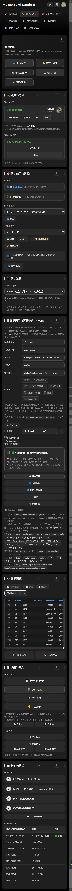
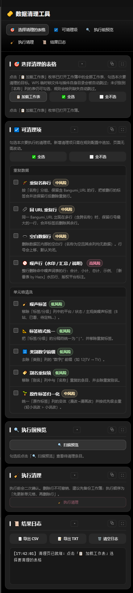

[](LICENSE)
[](https://www.typescriptlang.org/)
[](#sec-5)
[](https://github.com/awujiana)
[](#sec-13)

[](https://github.com/awujiana/My-Bangumi-Database-for-WPS/releases)
[](https://github.com/awujiana/My-Bangumi-Database-for-WPS/stargazers)
[](https://github.com/awujiana/My-Bangumi-Database-for-WPS/issues)

<div align="center">

[](images/mbd-logo.svg)

<h1>我的 Bangumi 資料庫 (WPS版)</h1>
<h2>My-Bangumi-Database-for-WPS</h2>

<strong>在 WPS 試算表中管理 Bangumi 番組資料：上傳同步、資料同步、收藏下載、新番表擴充與資料清理</strong>

</div>

> [!WARNING]
> 本專案有相當一部分程式碼由 AI 輔助產生，並經過持續的人工處理、整合測試與重構，但它仍然可能存在遺漏、邊界情況處理不足，或行為與預期不完全一致的問題。如果你在使用過程中發現 Bug、相容性問題、異常行為或文件缺失，歡迎積極提交 Issue。最好附上重現步驟、日誌、截圖和系統版本資訊，這會非常有幫助。

<p align="center">
  <strong>語言</strong>：
  <a href="README.md">简体中文</a> ·
  <a href="README.zh-TW.md">繁體中文</a> ·
  <a href="README.en.md">English</a>
  &nbsp;&nbsp;|&nbsp;&nbsp;
  <strong>文件</strong>：
  <a href="#sec-11">文件索引</a> ·
  <a href="CONTRIBUTING.md">貢獻指南</a> ·
  <a href="CHANGELOG.md">更新日誌</a> ·
  <a href="文档/待办-多语言支持.md">多語言支援（簡中）</a>
</p>

## 📚 目錄

- [專案簡介](#sec-1)
- [核心特色](#sec-2)
- [無障礙與設計基線](#sec-2a)
- [介面預覽](#sec-2b)
- [技術堆疊](#sec-3)
- [目錄結構](#sec-4)
- [環境需求](#sec-5)
- [安裝到 WPS 使用環境](#sec-5b)
- [更新到新版本](#sec-5c)
- [開發除錯](#sec-6)
- [建置與封裝](#sec-7)
- [設定備份與更新安全](#sec-7b)
- [使用範例](#sec-8)
- [測試](#sec-9)
- [程式碼規範與貢獻](#sec-10)
- [文件索引](#sec-11)
- [後續計畫（TODO）](#sec-11b)
- [資料來源](#sec-12)
- [回饋建議](#sec-13)
- [參考與致謝](#sec-13b)
- [贊助支持](#sec-13c)
- [開源授權](#sec-14)

<a id="sec-1"></a>

## 🚀 專案簡介

**My Bangumi Database for WPS** 是一個執行在 **WPS Office** 中的試算表外掛，用於在本機試算表與 [Bangumi 番組計畫](https://bgm.tv/) 之間雙向搬運資料：

- **上傳同步**：把試算表裡的觀看狀態 / 評分 / 標籤批次寫回 Bangumi；
- **資料同步**：從公開資料儲存庫拉取 Bangumi 資料，依 SID 增量寫入試算表；
- **收藏下載**：把 Bangumi 收藏列表標記到試算表；
- **新番表擴充 / 資料清理 / 番劇醒目提示 / 條件格式管理**：把追番表整理成可長期維護的樣子。

資料來源由姊妹儲存庫 [Bangumi-Archive-Anime-Excel](https://github.com/awujiana/Bangumi-Archive-Anime-Excel) 每週從 Bangumi 官方 Archive 處理後下發，外掛免 Token 即可同步。

> [!IMPORTANT]
> **網路說明：`https://bgm.tv/` 在中國大陸無法直連。** 上傳同步、收藏下載、Token 驗證等直接存取 Bangumi 的功能需要自備代理 / 加速工具，並讓 WPS 的網路請求走該代理；請自行解決網路環境問題。若只想離線整理資料，可使用「資料同步」（從 GitHub / GitLab / Gitee / Gist / 本機檔案拉取 Archive 資料），該路徑不依賴 bgm.tv。

---

<a id="sec-2"></a>

## ✨ 核心特色

| 能力                 | 說明                                                                                                                                                                                                                                                                                                                                                                                                                                                                                                                                                                                                                                                                                                                                                                                                                                                                                                                                                                                                                                                                                  |
| -------------------- | ------------------------------------------------------------------------------------------------------------------------------------------------------------------------------------------------------------------------------------------------------------------------------------------------------------------------------------------------------------------------------------------------------------------------------------------------------------------------------------------------------------------------------------------------------------------------------------------------------------------------------------------------------------------------------------------------------------------------------------------------------------------------------------------------------------------------------------------------------------------------------------------------------------------------------------------------------------------------------------------------------------------------------------------------------------------------------------- |
| 📤 **上傳同步**      | 將試算表中的觀看狀態、評分、標籤批次同步到 Bangumi API（指數退避重試 + 請求競態防護）。                                                                                                                                                                                                                                                                                                                                                                                                                                                                                                                                                                                                                                                                                                                                                                                                                                                                                                                                                                                               |
| 📥 **資料同步**      | 從遠端儲存庫（GitHub / GitLab / Gitee / Gist / 本機檔案）下載 Bangumi 資料 JSONL 並增量寫入試算表，內建 24 小時本機快取與 DJB2 雜湊比對。                                                                                                                                                                                                                                                                                                                                                                                                                                                                                                                                                                                                                                                                                                                                                                                                                                                                                                                                             |
| ↩️ **收藏下載**      | 從 Bangumi 拉取收藏列表標記到試算表；工作表為空時可自動填入為 Bangumi 帳號收藏條目，再標記到試算表。                                                                                                                                                                                                                                                                                                                                                                                                                                                                                                                                                                                                                                                                                                                                                                                                                                                                                                                                                                                  |
| 🔄 **5 種同步策略**  | `add-update` / `add-only` / `update-only` / `mirror` / `force-overwrite`。                                                                                                                                                                                                                                                                                                                                                                                                                                                                                                                                                                                                                                                                                                                                                                                                                                                                                                                                                                                                            |
| ✅ **同步偏好**      | 增量同步、衝突略過、同步記錄開關、預設收藏列表類型、預設時間篩選範圍、自動重新整理間隔；基於同步記錄的「復原同步」。                                                                                                                                                                                                                                                                                                                                                                                                                                                                                                                                                                                                                                                                                                                                                                                                                                                                                                                                                                  |
| 🎨 **外觀主題**      | 深色 / 淺色 / 跟隨系統 / 排程四種模式；設定頁日夜開關（太陽 / 月亮滑桿）點一下即從按鈕中心向外擴散切換，可設深淺起止時間。                                                                                                                                                                                                                                                                                                                                                                                                                                                                                                                                                                                                                                                                                                                                                                                                                                                                                                                                                            |
| 🌐 **多語言**        | 簡體 / 繁體 / 英文三語，各 **2008 key 全覆蓋**；切換語言即時生效（ribbon 按鈕文案要下次啟動）。語言包隨外掛發佈，設定頁可「更新語言包」（下載 → 驗證 SHA-256 → 寫入，壞包一個位元組都不寫）或「開啟語言包目錄」手動放入。                                                                                                                                                                                                                                                                                                                                                                                                                                                                                                                                                                                                                                                                                                                                                                                                                                                             |
| ⌨️ **快速鍵**        | 六個面板跳轉可自訂鍵盤組合（錄製式改綁、重複組合拒絕儲存並指出佔用者）；側欄導覽支援中鍵 / Ctrl+左鍵手勢（專注 / 隱藏）。                                                                                                                                                                                                                                                                                                                                                                                                                                                                                                                                                                                                                                                                                                                                                                                                                                                                                                                                                             |
| 🧩 **模組排序**      | 每頁模組可拖曳或 ↑↓ 排序；眼睛按鈕可逐模組隱藏，也能一鍵隱藏整條側欄功能導覽（窄工作窗格時主區鋪滿）。                                                                                                                                                                                                                                                                                                                                                                                                                                                                                                                                                                                                                                                                                                                                                                                                                                                                                                                                                                                |
| 🎛️ **條件格式口徑**  | **「套用條件格式」預設增量**：只把「我的規則 / 預設規則集」寫進表，表上已有同「範圍 + 公式」的只重新整理顏色、缺的補上，**既有規則一條都不刪**（手動建立的、別的工俱建立的都留著）；只有本外掛上一輪寫過、規則庫裡已刪掉的才會被移除（帳本 `conditionalFormat.applied.v1` 按表記錄）。真要重來用 `🧹 清空整表後套用`（危險按鈕，先列列表再確認）。寫後逐條回讀，沒落地的規則名稱會直接出現在提示裡。「工作表規則」的「自動聚類」可按公式 / 範圍+公式 / 欄 / 列分組；「🔗 合併重複項」把同公式同欄的多條單列規則合併（僅連續列 / 強行併成一塊兩種口徑），均在設定頁切換。工作表規則每列可 ✎ 編輯（範圍 / 公式 / 顏色）與 ⧉ 複製；「匯出規則」支援匯出到檔案 / 剪貼簿；「我的規則」可 ⧉ 複製所選後一次貼上多條（表格展示、可批次統一範圍），三處都能「✎ 批次修改」範圍 / 公式 / 顏色；「匯入工作表規則」右側 ▾ 還能從檔案（專案匯出的 .json）或文字匯入；目標工作表選擇器按數量自動切換單選 / 搜尋。四張表（工作表規則 / 我的規則 / 匯入彈框 / 貼上表格）都能**拖表頭改欄寬、拖表頭下緣改列高**（雙擊把手回到自動），尺寸按表記住；預設是隨窗格寬度自動適應的範本，沒拖過的欄不會變死。 |
| 📌 **錨定 / 固定**   | 組標題「📌」= 錨定整欄：把該組規則的套用範圍改寫成 `$J:$J`（多欄 `$J:$L`），**公式不變**，之後增刪列不再影響它；「📎 固定儲存格」= 釘到單一 `$J$5`，刪列刪欄後仍只作用於該儲存格，改動後按「🔧 恢復錨定」一鍵修回。記錄隨設定匯出備份。                                                                                                                                                                                                                                                                                                                                                                                                                                                                                                                                                                                                                                                                                                                                                                                                                                               |
| 🗓️ **季度/年度篩選** | 醒目提示頁支援「全部 / 年度 / 季度 / 月份 / 未來番」篩選，與 GitHub 同步篩選同口徑；「篩選顯示」直接隱藏表格中不命中的列。                                                                                                                                                                                                                                                                                                                                                                                                                                                                                                                                                                                                                                                                                                                                                                                                                                                                                                                                                            |
| 🪄 **新番表擴充**    | 自動補全新番表的名稱 / 別名差異，對映 infobox 欄位，減少手動輸入。                                                                                                                                                                                                                                                                                                                                                                                                                                                                                                                                                                                                                                                                                                                                                                                                                                                                                                                                                                                                                    |
| 🔑 **Token 管理**    | 設定、測試、複製、清除 Bangumi API Token。                                                                                                                                                                                                                                                                                                                                                                                                                                                                                                                                                                                                                                                                                                                                                                                                                                                                                                                                                                                                                                            |
| 🆕 **檢查更新**      | 從 GitHub Release 檢查新版本，彈窗顯示版本與更新說明，帶下載進度與可複製日誌；**一鍵自動安裝**：確認後 WPS 自動關閉 → 覆蓋外掛目錄 → 自動重新開啟（裝前整份備份、失敗回滾，有未儲存文件時拒絕安裝）。                                                                                                                                                                                                                                                                                                                                                                                                                                                                                                                                                                                                                                                                                                                                                                                                                                                                                 |
| 💙 **贊助頁**        | 功能區「贊助」按鈕開啟贊助頁，含作者 GitHub、信箱、粉絲 QQ 群與微信贊助碼。                                                                                                                                                                                                                                                                                                                                                                                                                                                                                                                                                                                                                                                                                                                                                                                                                                                                                                                                                                                                           |
| ⚙️ **雙面板 UI**     | 主面板 + 設定面板動態停靠協調；設定面板側邊功能導覽（支援僅圖示 + 懸停提示）；基於 `data-action` 的統一事件分發（30+ action）。                                                                                                                                                                                                                                                                                                                                                                                                                                                                                                                                                                                                                                                                                                                                                                                                                                                                                                                                                       |

---

<a id="sec-2a"></a>

## ♿ 無障礙與設計基線

介面依 [WCAG 2.2 AA](https://www.w3.org/TR/WCAG22/) 與「十大可用性原則 + Refactoring UI 七視角」落實。深淺兩套主題共用一套 token（`css/tokens.css`），顏色不寫死在元件裡。

**自動走查口徑**（真實瀏覽器 headless Chrome；7 個頁面 × 深 / 淺雙主題 × 320 / 375 / 768 / 1280 四個視窗尺寸）：

| 檢查項             | 基線                               | 實測       |
| ------------------ | ---------------------------------- | ---------- |
| 正文文字對比度     | ≥ 4.5:1（大字 ≥ 3:1）              | 0 處未達標 |
| 指標目標尺寸       | ≥ 24×24 CSS px（正文內嵌連結除外） | 0 處未達標 |
| 整頁橫向溢出       | 無                                 | 0 處       |
| 圖示按鈕可存取名稱 | 全部有 `title` / `aria-label`      | 0 處缺失   |

> 這是自動掃描結果，**不等於**合規認證：鍵盤走查、真實輔助技術（NVDA / 朗讀程式）與真實使用者測試仍需人工進行。

**幾條硬約定**（改樣式時別踩）：

- **填色與文字色分開**：`--danger` / `--success` / `--accent-blue` 是**填色**（鋪底、描邊、承載白字）；當文字用必須換成 `--text-danger` / `--text-success` / `--text-link`。同一個色值在淺色主題上當文字必然失守（`#2f7fe0` 在 `#eef0f3` 上只有 3.51:1）。
- **弱化文字 `--text-3` 已按最深 / 最淺底色驗算**：深色 `#a0a0a0`（最差 4.69:1）、淺色 `#5f646c`（最差 4.72:1）。再調淺 / 調深就會跌破 4.5。
- **漸層背景的對比度按每個色標算**，不能只看 `background-color`——漸層元素的 `backgroundColor` 是透明的，只回溯父層會把「淺底深字」誤判成「深底深字」。
- **窄工作窗格（320px）單欄**是硬要求，不允許靠縮小字級或點擊區塞下桌面版面。

---

<a id="sec-2b"></a>

## 🖼️ 介面預覽

<p align="center">
  
  
</p>

> 截圖取自實際外掛介面（深色主題）；不同 WPS 版本與視窗寬度下，面板會自動切換為單欄 / 雙欄版面。

---

<a id="sec-3"></a>

## 🧰 技術堆疊

- **語言**：TypeScript（strict 模式，ES2022 目標）
- **建置**：Vite 6（封裝 `dist/`）+ `tsc`（編譯 `dist-ts/`）
- **執行環境**：WPS Office JSAPI（ET 外掛），透過 `wpsjs` CLI 除錯
- **程式碼品質**：ESLint 8（含 `@typescript-eslint/strict-type-checked` 型別檢查層級，全量 0 error）+ Prettier 3 + Husky + lint-staged
- **測試**：Vitest 4（含 `@vitest/coverage-v8`）
- **執行期相依**：`zod`（資料驗證）、`dompurify`（HTML 淨化）
- **建置期相依**：`@napi-rs/canvas` / `@resvg/resvg-js`（影像匯出）

---

<a id="sec-4"></a>

## 📂 目錄結構

以下為發佈包 **`My-Bangumi-Database-for-WPS-v2.5.1.zip`** 解壓後的目錄結構（即使用者安裝到 WPS 後實際載入的檔案，不含原始碼 / 測試 / 文件）：

```
My-Bangumi-Database-for-WPS-v2.5.1/
├── index.html                  # 外掛入口（WPS 啟動時載入）
├── main.js                     # 動態模組載入器（Ribbon 早期佔位 + 模組就緒後替換真實實作）
├── manifest.xml                # 外掛清單（ApiVersion / Name）
├── ribbon.xml                  # 功能區按鈕設定（「Bangumi同步」Tab）
├── wpsjsrpcsdk.js              # WPS JSAPI RPC SDK
├── assets/                     # Vite 雜湊資源
│   ├── main.<hash>.js          # 主入口封裝產物
│   ├── logger.<hash>.js        # 日誌模組
│   └── data-export.<hash>.js   # 資料匯出模組
├── css/                        # 全域與各頁樣式
│   ├── tokens.css              # 設計變數（顏色 / 間距 / 字級）
│   ├── styles.css              # 通用元件與 Toast
│   ├── panel-theme.css         # 面板主題與頂欄
│   ├── clean.css
│   ├── conditional-format.css
│   ├── context-menu.css
│   ├── detachable-panel.css
│   ├── diff.css
│   ├── donate.css
│   ├── enrich.css
│   ├── highlight.css
│   ├── sortable-list.css
│   └── update-dialog.css
├── dist-ts/                    # tsc 編譯產物（執行期相依）
│   ├── index.js
│   ├── ribbon.js
│   ├── core/                   # 常數、錯誤處理、結果、進度、型別
│   ├── entry/                  # ribbon / panel / settings 入口
│   ├── panel/                  # 主面板、設定、清理、擴充、醒目提示、條件格式、贊助頁邏輯
│   ├── schemas/                # zod 驗證 schema
│   ├── services/               # 設定 / Ribbon 服務
│   ├── sync/                   # 同步引擎（github / gitlab / gitee / gist / 本機檔案 / Archive）
│   ├── tools/                  # 工具函式（http / wps / logger / sanitize / clipboard ...）
│   └── ui/                     # 面板 UI 與 handlers/
├── images/                     # 功能區與面板圖示（SVG）、贊助 QR Code
├── locales/                    # 語言包（簡體 / 繁體 / 英文）
│   ├── index.js                # 語言包清單（code / version / updatedAt / sha256 / 覆蓋率）
│   ├── zh-CN/locale.js         # 簡體（來源語言，由 ui/*.html 的 data-i18n* 反向擷取）
│   ├── zh-TW/locale.js         # 繁體
│   └── en/locale.js            # 英文
├── libs/                       # 執行期第三方函式庫
│   ├── fit-viewport.js
│   ├── purify.js               # DOMPurify UMD
│   ├── purify.min.js.map
│   └── wps-sdk-loader.js
└── ui/                         # 面板 HTML
    ├── sync-panel.html         # 同步面板
    ├── settings.html           # 設定面板
    ├── clean.html              # 資料清理
    ├── conditional-format.html # 條件格式管理
    ├── donate.html             # 贊助頁
    ├── enrich.html             # 新番表擴充
    └── highlight.html          # 番劇醒目提示
```

> 上述結構是 **`publish` 分支 / 發佈 zip** 的內容。預設分支 **`main`** 是完整原始碼工作區，在上面之外還含 `tests/`、`scripts/`、`package.json` 與 `tsconfig*` / `vite.config`，`git clone` 後 `npm install` 即可跑 `npm run gate` / `npm run build`。

<details>
<summary>📂 ts/ 原始碼結構（供查閱）</summary>

```
ts/
├── core/        # 常數、型別、結果、錯誤處理、UI 橋接
├── entry/       # ribbon / panel / settings 入口
├── panel/       # 主面板、設定、清理、擴充、醒目提示、條件格式、贊助頁邏輯
├── schemas/     # zod 驗證 schema
├── services/    # 設定 / Ribbon 服務
├── sync/        # 同步引擎（github / gitlab / gitee / gist / 本機檔案 / Archive）
├── tools/       # 工具函式（http / wps / logger / sanitize / clipboard / theme ...）
├── ui/          # DOM 元件、對話框、handlers（data-action 分發）
├── index.ts
└── ribbon.ts
```

</details>

---

<a id="sec-5"></a>

## 🔧 環境需求

| 相依       | 版本                    | 說明                                     |
| ---------- | ----------------------- | ---------------------------------------- |
| WPS Office | 2019+（Windows）        | 需支援 JSAPI / 外掛除錯（`wpsjs debug`） |
| Node.js    | 18+（建議 LTS 20 / 22） | 建置與除錯工具鏈                         |
| npm        | 隨 Node 安裝            | 套件管理                                 |
| Git        | 較新版本                | 版本控制                                 |

---

## 📥 開發者環境建置（僅開發需要）

> 這是**開發外掛本身**的步驟，需在預設分支 `main` 上執行（`publish` 分支只有發佈檔案，缺 `package.json` 與建置設定，在那裡 `npm install` 會失敗）。一般使用者安裝外掛請看下一節 [安裝到 WPS 使用環境](#sec-5b)，無需 Node / 建置。

```bash
# 1. 複製儲存庫
git clone https://github.com/awujiana/My-Bangumi-Database-for-WPS.git
cd My-Bangumi-Database-for-WPS

# 2. 安裝相依
npm install
```

> `wpsjs`、`vite` 等 CLI 已作為 devDependencies 隨 `npm install` 安裝，無需全域安裝。

---

<a id="sec-5b"></a>

## 📦 安裝到 WPS 使用環境

外掛是 WPS 試算表（ET）外掛。部署遵循 WPS 官方「publish.xml 模式」（建議）與「jsplugins.xml 模式」，最終使用者拿到的是**建置產物**，無需 Node / 建置環境。

### 方式一：開發者除錯安裝（僅開發時）

```bash
npm run debug
```

`wpsjs debug` 會編譯 TypeScript、啟動除錯伺服器（預設埠 `3889`），並自動在 WPS 中註冊一個除錯外掛；啟動 WPS 試算表後即可在「Bangumi同步」索引標籤看到按鈕。詳見 [開發除錯](#sec-6)。

### 方式二：使用者安裝（正式環境，離線 / 本機）

1. **取得外掛包**
   - 開發者：見 [建置與封裝](#sec-7)，`npm run build` 產出的 `dist/` 目錄（含 `index.html` / `manifest.xml` / `ribbon.xml` / `images/` / `ui/` / `dist-ts/` / `css/` / `libs/` / `locales/` / `assets/`）就是完整外掛包。
   - 使用者：直接從 [GitHub Releases](https://github.com/awujiana/My-Bangumi-Database-for-WPS/releases) 下載發佈的 `My-Bangumi-Database-for-WPS-vX.Y.Z.zip`，解壓得到外掛目錄。

2. **註冊到 WPS**

   WPS 各系統讀取外掛清單的目錄：

   | 系統        | 外掛目錄                                                                      |
   | ----------- | ----------------------------------------------------------------------------- |
   | **Windows** | `%APPDATA%\kingsoft\wps\jsaddons`                                             |
   | **macOS**   | `~/Library/Containers/com.kingsoft.wpsoffice.mac/Data/.kingsoft/wps/jsaddons` |
   | **Linux**   | `~/.local/share/Kingsoft/wps/jsaddons`                                        |

   > Windows 上最快的到達方式：`Win + R` → 輸入 `%appdata%` → Enter，再依序進入 `kingsoft\wps\jsaddons`。
   > 例：`C:\Users\Administrator\AppData\Roaming\kingsoft\wps\jsaddons`
   - **(建議) 安裝器 / publish.html**：用 WPS 官方 `wpsjs` 工具鏈產生的 `publish.html`（離線模式）或 `wpsjs build --exe` 產生的安裝器，瀏覽器開啟後點「安裝」，會自動寫入上面的 `publish.xml`。
   - **手動註冊**：把解壓後的外掛目錄放到 `%appdata%\kingsoft\wps\jsaddons\My Bangumi Database for WPS_2.5.1\`，並編輯同目錄的 `publish.xml`（不存在則新建），加入一條外掛：

     ```xml
     <?xml version="1.0" encoding="UTF-8" standalone="yes"?>
     <jsplugins>
       <jsplugin name="My Bangumi Database for WPS"
                 url="file:///C:/Users/你/jsaddons/My Bangumi Database for WPS_2.5.1/"
                 enable="true"/>
     </jsplugins>
     ```

     > `url` 指向**包含 `index.html` 的目錄**，可用 `file:///` 本機路徑或 `http(s)://` 伺服器位址；多個外掛在同一 `publish.xml` 中各寫一條 `<jsplugin>` 即可。

3. **解除安裝**

   **操作前請務必先完全關閉 WPS**（含系統匣裡的 WPS 雲端服務程序），否則檔案被佔用會刪不掉：

   1. 進入上表的外掛目錄（Windows：`%APPDATA%\kingsoft\wps\jsaddons`）；
   2. 找到本外掛的資料夾 —— 名為 `My-Bangumi-Database-for-WPS_2.5.1`（或 `my-bangumi-database-for-wps_2.5.1`、以及帶版本號後綴的類似名稱），**整目錄刪除**；
   3. 選用：編輯同目錄的 `publish.xml`，刪掉指向該目錄的 `<jsplugin .../>` 那一行（只刪這一行）。

   > ⚠️ 不要刪除整個 `jsaddons` 資料夾，也不要刪掉 `publish.xml` 本身 —— 裡面可能還有其它外掛的註冊資訊，刪了會一起失效。
   > 解除安裝只移除外掛檔案，**試算表裡的資料與 `%APPDATA%` 下其它 WPS 設定不受影響**；外掛設定（Token、偏好）隨 `PluginStorage` 儲存在文件與宿主側，重裝後通常仍在。

4. **啟用**：關閉並重新開啟 WPS 試算表。首次出現「Bangumi同步」索引標籤時會請求允許，允許後約半分鐘載入完成（可在 WPS「應用中心 / 外掛」裡管理啟用 / 停用）。

### 方式三：線上部署（區域網路 / 伺服器）

將 `dist/` 部署到 Web 伺服器（需 `https://` 或完整 `http://` 位址，例如 `https://example.com/bgm/`），再用 `wpsjs publish`（或手動產生 `publish.html`）把安裝頁分發給使用者；使用者在瀏覽器開啟 `publish.html`、狀態顯示「正常」後點「安裝」即可。`wpsjs publish` 會把 `wps-addon-build/` 部署到伺服器，並把 `wps-addon-publish/publish.html` 作為安裝入口。

> `npm run debug` 僅用於開發整合；正式給使用者的是方式二 / 方式三的建置產物，對方無需安裝 Node。

---

<a id="sec-5c"></a>

## 🔄 更新到新版本

裝好之後不必再手動找包覆蓋：設定頁底部有「檢查更新」，走完流程即可。

### 方式一：一鍵自動安裝（Windows，建議）

設定頁 → 捲到最底部「關於」→ 點 **檢查更新** → 發現新版後點 **⬇️ 下載並安裝**。

彈窗裡會先告訴你「點下去會發生什麼」，確認後依序自動完成：

1. **下載**更新包（帶進度條，每 10% 記一行日誌）；
2. **驗證 SHA-256**：與發佈清單 `download/version.json` 裡的雜湊比對，
   不一致**直接拒絕安裝**（連安裝指令碼都不會產生）；
3. **關閉 WPS**（3 秒後請求結束，留時間讓你看完日誌）；
4. 安裝程式等 WPS 結束（最多 180 秒）→ **整份備份**外掛目錄 → 覆蓋解壓 →
   **自動重新開啟 WPS**。解壓失敗會用備份回滾，外掛仍是舊版可用狀態。

安全邊界（這幾條是刻意設計的，不是「信任作者」）：

- 安裝指令碼由外掛**內建常數產生**，全程不下載任何指令碼；指令碼裡也**不連網**，
  更新包只能來自外掛自己下載並驗證過的那份位元組，指令碼還原後還會再複核一次雜湊與 zip 魔數；
- 指令碼與更新包放在**每次新建的隨機暫存目錄**（`%TEMP%\bgm-update-<16 位隨機>\`），
  不重複使用可預測的檔名；
- **只替換程式檔案**。設定、Token、帳號、條件格式規則存在 WPS 的外掛儲存裡，
  不在安裝目錄中，不會被覆蓋；
- 偵測到**未儲存的文件**會直接拒絕安裝（避免關 WPS 時把工作丟掉）；
- 安裝日誌：`%TEMP%\bgm-update-<版本>.log`（失敗時彈窗裡也會給出路徑）。

### 方式二：手動安裝（macOS / Linux，或自動安裝不可用時）

自動安裝依賴 PowerShell，**僅 Windows 可用**。其他情況：

1. 設定頁 → 檢查更新 → 下載並安裝；若自動安裝不可用，更新包會存到瀏覽器下載目錄
   （日誌裡會寫明檔名）；
2. **完全關閉 WPS**；
3. 解壓更新包，把裡面的內容覆蓋到外掛目錄
   （`%APPDATA%\kingsoft\wps\jsaddons\My-Bangumi-Database-for-WPS_<版本>\`，
   macOS / Linux 見[安裝](#sec-5b)裡的路徑表）；
4. 重新開啟 WPS。

> 手動安裝不會動你的設定與資料——它們不在外掛目錄裡。
> 覆蓋前建議先把整個外掛目錄複製一份備份。

### 驗證發佈包（選用，想自己核一遍時）

`download/version.json` 裡帶 `sha256` 與 `size`：

```bash
# Windows PowerShell
Get-FileHash .\My-Bangumi-Database-for-WPS-v2.5.1.zip -Algorithm SHA256
# macOS / Linux
shasum -a 256 My-Bangumi-Database-for-WPS-v2.5.1.zip
```

兩個值一致才說明這份包沒被改過。

---

<a id="sec-6"></a>

## 🐞 開發除錯

> 以下命令僅適用於維護者的完整原始碼工作區；本儲存庫只提供 `ts/` 原始碼，不提供建置指令碼與相依設定。

外掛透過 WPS 的 `wpsjs debug` 啟動除錯工作階段（會編譯 TS 並拉起 WPS 外掛）：

```bash
# 建議：一鍵除錯（先 tsc 編譯，再 watch + 啟動 WPS 除錯）
npm run debug
```

`npm run debug` 等價於：

```bash
npm run build:ts                 # tsc --project tsconfig.build.json → dist-ts/
# 並行：tsc --watch 監聽改動 + wpsjs debug 拉起 WPS
```

- **除錯入口**：WPS 啟動時載入 `index.html`，`main.js` 完成 Ribbon 早期佔位；TypeScript 模組就緒後由 `ts/ribbon.ts` 透過 `window._bgmRibbonReady` 替換真實實作並 `Invalidate` 重新整理圖示。
- 若僅需 Vite 開發伺服器（`npm run dev`，埠 `5173`）：**生產建置與 WPS 載入仍使用 `npm run debug` / `npm run build`**，Vite dev server 僅用於前端資源除錯，不代表最終載入行為。`dev` 埠已與 wpsjs 除錯埠（`3889`）錯開，避免衝突。

---

<a id="sec-7"></a>

## 📦 建置與封裝

```bash
# 完整建置：tsc → dist-ts/ ，再 Vite 封裝 → dist/
npm run build

# 僅編譯 TypeScript（不封裝）
npm run build:ts
```

**建置產物**：

- `dist-ts/`：`tsc` 編譯後的 JS（被 `main.js` / `sync-panel.html` 執行期相依）。
- `dist/`：`vite build` 輸出，含 `manifest.xml`、`ribbon.xml`、`images/`、`ui/`、`main.js`、`dist-ts/**`、`css/`、`locales/` 與經雜湊的 `assets/`。將此目錄作為外掛發佈包部署到 WPS。

#### 封裝發佈到 Releases（離線分發）

WPS 官方 `wpsjs` 工具包提供 `wpsjs build` 產生離線安裝包（輸出 `wps-addon-build/`，加 `--exe` 可產生 Windows 安裝器），用於離線分發。本儲存庫的外掛由 Vite 建置，**等價的可分發目錄是 `npm run build` 產出的 `dist/`**——把 `dist/` 壓縮即可作為離線包上傳 Releases：

```bash
# 1. 建置完整外掛包（產物在 dist/）
npm run build

# 2. 壓縮為發佈包（版本號取自 package.json 的 version）
VERSION=$(node -p "require('./package.json').version")
zip -r "My-Bangumi-Database-for-WPS-v${VERSION}.zip" dist
```

將 `My-Bangumi-Database-for-WPS-vX.Y.Z.zip` 上傳到 [GitHub Releases](https://github.com/awujiana/My-Bangumi-Database-for-WPS/releases)，使用者按 [安裝到 WPS 使用環境](#sec-5b) 的「方式二」下載解壓、註冊即可，無需 Node 與建置。

> 若沿用 WPS 標準 `wpsjs` 專案版面，也可直接 `wpsjs build`（產生 `wps-addon-build/` + `wps-addon-publish/publish.html`）後將該產物壓縮上傳；兩種產物在電腦上都是「含 `index.html` 的目錄」，安裝方式一致。

**Windows 安裝器的圖示**：`wpsjs build --exe` 產出的是 wpsjs 預設圖示。儲存庫內建了自動化：

```bash
npm run icon                      # 用 images/app-icon.ico 換圖示 → release/<版本>.exe
npm run icon -- --icon D:/x.ico   # 換一個 ico
npm run icon:merge                # images/ 裡的多個單尺寸 ico → 合成 images/app-icon.ico
```

指令碼走 Resource Hacker 命令列（`-action addoverwrite -mask ICONGROUP,MAINICON,`），換完會驗證「除 `.rsrc` 外所有節逐位元組相同」+「ico 裡每張圖都進了 exe」，任一不過就刪產物並報錯。

圖示本身想用多尺寸：**已經是一個多尺寸 ico** 就直接覆蓋 `images/app-icon.ico`，不用改程式碼；手裡是「16.ico / 32.ico / 48.ico …」一堆**單尺寸檔案**時，全丟進 `images/`（或任意目錄）再跑 `npm run icon:merge -- --merge-dir <目錄>`，指令碼按尺寸遞增合成、同尺寸只留資料較大的一張、寫完回讀逐張比對。目前 `images/app-icon.ico` 就是 16/24/32/48/64/128/256 七張合成的（10,977 B）。

**外掛品牌圖示**：`images/mbd-logo.svg`（#1296db 配色、含 MBD 字樣），隨 `dist/`（或 `wpsjs build` 產物）一併封裝進外掛，同時作為 README 標題標識與 Releases 資源使用。

### 維護者：兩棵工作樹 + 發佈流程

本機維護時存在**兩棵內容一致、職責不同**的樹（不要在兩棵樹裡各改一半）：

| 樹                               | 位置（本機）                                  | 職責                                                                                              |
| -------------------------------- | --------------------------------------------- | ------------------------------------------------------------------------------------------------- |
| **開發樹**                       | `Excel加载项/BGM/restore-src`                 | 含 `tests/`、`scripts/`、`package.json` / `tsconfig*` / `vite.config`，跑 `npm run gate` 全量門禁 |
| **發佈樹**（= 本 GitHub 儲存庫） | `Excel加载项/BGM/My-Bangumi-Database-for-WPS` | 只放發佈檔案 + `ts/` 原始碼 + `dist-ts/`；遠端 `origin` 指向 GitHub                               |

標準流程：

1. 在**開發樹**改程式碼 → `npm run gate` 全綠（lint / 型別 / 門禁指令碼 / 全量單元測試）；
2. 把改動的檔案同步到**發佈樹**（`ts/`、`ui/`、`css/`、`images/` 等；`tests/` 不進發佈樹）；
3. 在發佈樹 `npm run build:ts` 重新產生 `dist-ts/`；
4. 提交後執行 `node ../publish.mjs`（或雙擊 `publish.cmd`）—— 指令碼會重建只含發佈檔案的 `publish` 分支並強推 `origin/main`，本機 `main` 保留工具鏈。

> ⚠️ 新增的 `dist-ts/**` 檔案被 `.gitignore` 擋住，`publish.mjs` 的 `git add -A` 收不到，必須明確 `git add -f dist-ts/...`，否則發佈包缺模組會直接白屏。
> ⚠️ 開發樹缺 `node_modules` 時，用目錄聯結重用發佈樹的相依（`New-Item -ItemType Junction`），不必重新 `npm install`。

---

<a id="sec-7b"></a>

## 💾 設定備份與更新安全

設定頁 → **設定管理** 提供一鍵備份與還原：

| 按鈕            | 作用                                                                       |
| --------------- | -------------------------------------------------------------------------- |
| 💾 儲存所有設定 | 把目前設定頁各表單的值寫回儲存。                                           |
| 📤 匯出設定     | 下載 `bgm-config-YYYY-MM-DD.json` 並複製到剪貼簿（一份檔案即全量備份）。   |
| 📥 匯入設定     | 貼上該檔案 JSON 還原；匯入後自動套用日誌層級並重新整理帳號 / GitHub 表單。 |
| ♻️ 重設所有設定 | 清空所有已儲存設定（謹慎，建議先匯出）。                                   |

**匯出範圍**：Bangumi Token 與多帳號列表（含使用者資料、到期時間）、GitHub 儲存庫設定（含同步來源類型、Gist ID、分片選擇、同步策略）、外觀（主題 / 排程切換 / 對話框按鈕位置）、導覽（圖示模式 / 分塊排序 / 摺疊隱藏）、快速鍵綁定、同步偏好、預設匯入匯出路徑、日誌層級、擴充（預覽設定 / 自動偵測）、番劇醒目提示（欄對映 / 模式 / 篩選範圍 / 非動漫）、條件格式（**規則庫 / 已套用規則帳本 / 目標工作表 / 聚類與合併口徑 / 分組命名 / 錨定與固定記錄**）、資料清理的規則開關。

**刻意不匯出**：工作階段狀態與快取 —— 各頁鎖定的工作表執行個體 `bgm_locked_sheet_*`、面板顯示訊號 `bgm_panel_shown_at`、COM 卡頓觀測 `bgm_com_stall_*`、資料脈絡 `bgm_data_context`、目標偵測快取 `bgm_target_detect_cache`；以及按活頁簿記住的清理勾選 `bgm_clean_sheets:`（鍵裡是本機檔案絕對路徑，換機器對不上，到新機器重新勾選即可）。

**更新會不會遺失設定**（結論：**正常更新不會遺失**）：

- 全部設定存在 WPS 的 **PluginStorage**（按外掛 ID 存放，獨立於外掛檔案）。更新 = 替換外掛目錄 / 覆蓋 `dist`，**不會**觸碰 PluginStorage —— 規則庫、錨定與固定記錄、帳號、主題與快速鍵等全部原樣保留。
- 會遺失的只剩三種情況：**解除安裝外掛**、**清理 WPS 快取 / 使用者資料**、**換機器**。這三種場景用上面的匯出 / 匯入兜底（匯入不需要重新建置，貼上 JSON 即可）。
- 執行記錄（同步記錄、系統日誌、擴充記錄、清理日誌）另在設定頁「資料匯出」匯出為 CSV / TXT，不屬於設定備份範圍。
- 反過來，外掛自身**不會**在啟動時清除使用者設定：不存在「升級即重設」的邏輯，重設只由使用者手動點「♻️ 重設所有設定」觸發。

---

<a id="sec-8"></a>

## 📖 使用範例

### 1. 設定 Bangumi Token

1. 在 Bangumi 個人設定中取得 **API Token**。
2. 點擊功能區 **設定Token**（或主面板 Token 區「設定」），貼上 Token。
3. 點擊 **測試Token** 驗證有效性，再點 **儲存**。

### 2. 上傳同步（Excel → Bangumi）

1. 在 Excel 中準備好追蹤表（含「名稱 / 是否看完 / 評分 / 標籤分級」等欄）。
2. 開啟 **同步面板**，在「資料選擇區」選擇目標活頁簿與工作表（支援自動 / 手動選擇模式）。
3. 點擊 **上傳同步**（整表）或 **選取列同步**（僅選取範圍）。
4. 即時進度條顯示成功 / 失敗 / 略過計數；完成後寫入同步記錄並以 Toast 總結。

### 3. 資料同步（遠端儲存庫 → Excel）

1. 開啟 **設定面板** →「遠端儲存庫設定」，填寫：

   | 設定項   | 值                            |
   | -------- | ----------------------------- |
   | 同步來源 | GitHub                        |
   | owner    | `awujiana`                    |
   | repo     | `Bangumi-Archive-Anime-Excel` |
   | branch   | `main`                        |
   | path     | `data/anime.manifest.json`    |

2. 選擇同步策略（`add-update` 預設，保守）。
3. 點擊 **立即同步**（或功能區 **資料同步**）。外掛讀取分片清單、只下載表頭命中的分片、與快取比對雜湊、再依 SID 增量寫入 Excel。
4. 可用 **復原同步** 回滾上一次操作；**清快取** 強制重新下載。

> 資料來源格式、清單欄位與選片規則見[資料儲存庫 README](https://github.com/awujiana/Bangumi-Archive-Anime-Excel)。

### 4. 新番表擴充

點擊功能區 **新番表擴充**，對「新番表」執行欄位自動補全（名稱 / 別名差異補全、infobox 欄位對映），減少手動輸入。

### 5. 條件格式：錨定整欄 / 整列 / 固定儲存格

開啟 **條件格式** 頁 →「目標工作表的既有規則」區：

1. **錨定整欄 / 整列**：組標題上有 **「欄」「列」** 兩個按鈕。
   - **欄**：套用範圍改寫成整欄（`$J:$J`，多欄 `$J:$L`），對「增刪列」免疫；
   - **列**：套用範圍改寫成整列（`$5:$5`，多列 `$5:$8`），對「增刪欄」免疫。
     兩者都**公式一個字不改**。
2. **固定儲存格**：點 **📎 固定儲存格**，輸入目標位址（如 `J5`），把選取規則（未選則全部）釘成
   `$J$5` 單格範圍。適合「就這一個儲存格要標色」的場景：無論前後刪了多少列欄，它只認這個位址。
3. **恢復**：增刪列欄後點 **🔧 恢復錨定**，外掛按錨定表把跑偏的範圍改回錨定值（開啟頁面時也會自動修一次）。
4. **匯出 / 備份**：**📤 匯出規則 ▾** 可選「匯出到檔案」或「複製到剪貼簿」（後者不用先選儲存位置）。
   錨定 / 固定記錄寫在 PluginStorage 裡，隨「設定 → 設定管理 → 📤 匯出設定」一起匯出；換機器匯入即可，
   **更新外掛不會遺失**（詳見 [設定備份與更新安全](#sec-7b)）。
5. **列內操作**：規則列不再放一排小按鈕，操作統一在**右鍵功能表**裡（匯入規則庫 / 歸入分組 /
   如果為真則停 / 上移 / 下移 / 刪除），列寬留給「套用於 / 公式」。
6. **目標工作表**：活頁簿 / 工作表選擇器按選項數量自動切換形態 —— ≤2 個用選項按鈕、>10 個帶搜尋框，
   中間數量用原生下拉（通用元件 `option-picker`）。

---

<a id="sec-9"></a>

## 🧪 測試

```bash
npm run gate             # 品質門禁（十三關，建議；提交前必跑）
npm test                 # 執行全部單元測試（Vitest）
npm run test:watch       # 監視模式
npm run test:coverage    # 產生覆蓋率報告
npm run check:guards-reverse   # 反向驗證門禁自身（改了 check-*.mjs 後手動跑）
npm run check:shard-layout     # 版面回歸門禁（改了 css/ 或分片區後手動跑，需本機 Chrome）
npm run audit:layout           # 全頁面版面稽核（改了 css/ 或頁面結構後手動跑，需本機 Chrome）
```

`npm run gate` 依序執行：`lint:check` → `check:dompurify-version` → `check:module-manifest` →
`check:cycles` → `check:ribbon-buttons` → `check:nav-order` → `check:com-in-loop` → `check:detachable`
→ `check:csp` → `check:i18n` → `check:wpsjs-patch` → `check:boot-com` → `typecheck:tests` → `test`。

`npm run check:guards-reverse` **不在 `gate` 內**：門禁裡有多道是**原始碼層級斷言**，而一條永遠為真的
斷言與有效斷言外觀完全相同 —— 都是綠的。該指令碼為這 6 條各注入一個「已知違規」，確認它們真的會紅，
**且失敗輸出裡出現預期片段**（指令碼掛了結束碼同樣非 0），最後逐位元組還原。
**新增原始碼層級斷言時必須同時在它的 `CASES` 裡補一個變異用例**，否則那條斷言只是「看起來在守門」。

`npm run check:shard-layout` 同樣**不在 `gate` 內**（相依本機 Chrome / Edge）：十三道關都是原始碼斷言或
單元測試，**沒有一道能發現樣式錯位** —— CSS 沒有型別系統，jsdom 也不做版面計算。這道門禁用
headless Chrome 渲染真實的分片區塊，在 320 / 400 / 500px 三種版面寬度下量**真實計算樣式**，
斷言「每個分片標籤的文字只佔 1 列、標籤高 ≤ 40px、核取方塊 ≤ 20px」。
改了 `css/**`、`sync-panel.html` 的分片區塊或分片文案之後跑一次。

`npm run audit:layout` 把同一套思路推廣到**全部 5 個頁面**：按「原生 checkbox/radio 渲染尺寸 > 20px」
「短文字（≤ 24 字）卻佔多列」「內容橫向溢出」三條客觀判據找錯位，一次就抓到 3 處與分片**同源**的 bug
（詳見 [`CHANGELOG.md`](CHANGELOG.md) 裡對應的修復記錄）。判據 2 是啟發式，命中項需人工確認；
命令支援 `--json` / `--widths 360,500` / 指定單一頁面。

目前基線：**5525 條測試 / 183 檔案**。

> **真實宿主（WPS / Excel）手動驗收**：單元測試覆蓋不到「宿主 API 的真實行為 / 真實網路 / 跨 WebView 通訊 / 真實大表效能」，
> 這部分只能真機逐項過：裝上 WPS 後按「使用範例」一節把六條主流程走一遍，重點看長表格捲動、網路中斷重試、多帳號切換與更新安裝。

---

<a id="sec-10"></a>

## 🤝 程式碼規範與貢獻指南

完整的開發環境、分支模型、提交規範、品質門禁與 PR 清單請見 **[CONTRIBUTING.md](CONTRIBUTING.md)**。以下為速覽。

### 分支與提交流程

1. 從 `main` 切出特性分支：`git checkout -b feat/xxx` 或 `fix/xxx`。
2. 開發，並確保通過 lint / format / test。
3. 使用 **Conventional Commits** 規範提交：

   ```
   <type>(<scope>): <subject>
   ```

   - `type`：`feat` / `fix` / `refactor` / `docs` / `test` / `chore` / `style` / `perf`
   - 範例：`feat(sync): 實作別名擴充 - 新番表名稱差異自動補全`、`fix: 修復狀態洩漏 + 統一 Button 命名空間`

4. 提交至 `main`（或發起 PR，視團隊流程）。

### 程式碼品質

- **ESLint**：`npm run lint:check`（檢查）/ `npm run lint`（自動修復），規則見 `.eslintrc.cjs`。
- **Prettier**：`npm run format:check` / `npm run format`，設定見 `.prettierrc`。
- **Husky + lint-staged**：`prepare` 安裝 Git hook，提交時自動對暫存檔案執行 lint / format（設定見 `lint-staged.config.js`、`.husky/`）。
- **TypeScript**：`tsconfig.json` 開啟 `strict`、`noUncheckedIndexedAccess`、`exactOptionalPropertyTypes` 等嚴格檢查；新增程式碼需通過 `npm run build:ts` 型別檢查。

### 架構約定

- **模組解耦 / 循環相依治理**：避免 `ts/` 模組間的循環相依（參見提交「循環相依治理與模組解耦完成」）。
- **面板命名**：統一 `taskpane` → `panel` 命名，頁面邏輯檔案使用 `Page` 後綴（`ts/panel/`）。
- **事件分發**：UI 透過 `data-action` 屬性 + 統一 `handleActionClick(action, event)` 路由（見 `ts/ui/handlers/`）。
- **持久化**：設定經 `PluginStorage` 儲存（`bgm_token` / `github_config` / `bgm_incremental_sync` / `bgm_theme` / `bgm_list_type` / `bgm_time_filter` / `bgm_refresh_interval` / `bgm_nav_icons_only` 等鍵）。
- **資料驗證**：外部資料經 `ts/schemas/` 下的 zod schema 驗證，再寫入 Excel。

### 擴充：新增同步來源 / 欄位對映

- **新增同步來源**：在 `ts/sync/` 下實作 `SyncSource` 介面並註冊到 `sync-source-registry.ts`。
- **欄位對映**：權威來源是 Archive 專案的 `Archive/config/field_mappings.json`（infobox 欄位名 → 標準欄名），本儲存庫不保留副本；改動後在 `ts/schemas/` 補充對應 zod 驗證。

---

<a id="sec-11"></a>

## 📚 文件索引

> 🧩 **想為 MBD 寫外掛？**先看[外掛開發規範 `PLUGIN-SPEC.md`](PLUGIN-SPEC.md)：`plugin.json` 欄位、權限清單、簽章驗證、宿主 API、首批外掛倉庫與發佈流程都在裡面；外掛市集頁面也放了同一份連結。

儲存庫內可直接讀的文件：

| 文件                                                 | 內容                                                                  |
| ---------------------------------------------------- | --------------------------------------------------------------------- |
| [`README.md`](README.md)                             | 安裝 / 更新 / 使用範例 / 建置封裝 / 設定備份（簡體中文）              |
| [`PLUGIN-SPEC.md`](PLUGIN-SPEC.md)                   | **外掛開發規範**：清單欄位 / 權限 / 簽章 / 宿主 API / 發佈流程        |
| [`README.zh-TW.md`](README.zh-TW.md)                 | 本頁（繁體中文）                                                      |
| [`README.en.md`](README.en.md)                       | 英文頁                                                                |
| [`CONTRIBUTING.md`](CONTRIBUTING.md)                 | 開發流程、提交規範、品質門禁、**命名規範（不縮寫）**                  |
| [`AGENTS.md`](AGENTS.md)                             | 給 AI agent 的專案約定與禁忌（核心不變量 / 技術禁令 / 改動前檢查）    |
| [`CHANGELOG.md`](CHANGELOG.md)                       | 按版本累積的變更記錄（含每處修復的成因與實測資料）                    |
| [`文档/待办-多语言支持.md`](文档/待办-多语言支持.md) | 多語言支援的實作記錄：P0–P5 階段、key 成長鏈、術語口徑、17 條踩坑經驗 |
| [`locales/术语表.md`](locales/术语表.md)             | 三語術語對照 + OpenCC 易錯詞 + 「刻意保留中文」清單                   |

> 測試與品質：執行 `npm run gate`（詳見「測試」一節）；測試檔案位於 `tests/`，不逐條索引。
> 架構說明與逐按鈕的使用者手冊**不隨儲存庫分發**，相關內容分散在本 README 的「目錄結構」「使用範例」「設定備份與更新安全」三節。

---

<a id="sec-11b"></a>

## 🗺️ 後續計畫（TODO）

| 事項                                  | 狀態         | 說明                                                                                                                                                                                                                                                                                                                                                       |
| ------------------------------------- | ------------ | ---------------------------------------------------------------------------------------------------------------------------------------------------------------------------------------------------------------------------------------------------------------------------------------------------------------------------------------------------------- |
| Ribbon 精簡模式（`dynamicMenu` 下拉） | **暫不實作** | 把「測試 Token / 複製 Token / 設定使用者 ID / 復原同步 / 關閉所有頁面」等低頻按鈕收進一個 `dynamicMenu` 下拉，減少功能區佔位。**為什麼先不做**：`dynamicMenu` 需要在 `ribbon.xml` 裡宣告 `getContent` 回呼並回傳 XML 片段，WPS 各版本對該回呼的重新整理時機不一致（改完要重開文件才生效），做出來容易變成「點了沒反應」。等有穩定的 WPS 版本基線後再實作。 |
| Ribbon 按鈕按設定隱藏                 | **不做**     | `getVisible` 在 WPS 的 JS 外掛裡支援不穩定（隱藏後常需重開文件），會製造「設定裡點了沒反應」的新問題。替代方案同上（收進 `dynamicMenu`）。                                                                                                                                                                                                                 |
| 各頁面的三語回歸（版面 + 漏標記文案） | **已做**     | 7 個頁面 × 500/400px × 簡/繁/英全跑 `npm run audit:layout`：中文、繁體全綠；英文 8 處換行逐張看截圖確認都是 `flex-wrap` / 網格等高拉伸，無裁切溢出，與已接受的 sync-panel 換行同性質。另加 `npm run audit:text` 掃「沒打 `data-i18n` 的中文」，14 處命中裡 2 處是真漏譯（高亮頁預覽計數、同步面板「使用引導」按鈕），已改為初始化時按當前語言寫一次。      |

> 想優先做哪一項，歡迎開 Issue 說明使用場景（附 WPS 版本號），排程會據此調整。

---

<a id="sec-12"></a>

## 🗂️ 資料來源

外掛預設從公開儲存庫 [`awujiana/Bangumi-Archive-Anime-Excel`](https://github.com/awujiana/Bangumi-Archive-Anime-Excel) 讀取 `data/anime.manifest.json`（分片清單），再按表頭選擇需要的分片（`anime.base.jsonlines.gz` 等）下載。資料來自 Bangumi 官方 Archive 每週 dump，經處理後按欄位分片、gzip 壓縮下發，外掛端免 Token 即可同步。

> 分片格式、清單欄位與選片規則見[資料儲存庫 README](https://github.com/awujiana/Bangumi-Archive-Anime-Excel)。

---

<a id="sec-13"></a>

## 💬 回饋建議

- **Bug / 功能建議**：請到 [Issues](https://github.com/awujiana/My-Bangumi-Database-for-WPS/issues) 提交，附上重現步驟、日誌、截圖與 WPS 版本。
- **粉絲 QQ 群**：**436212515** —— 用起來卡住了、想問某個站點怎麼設定、或者單純催更，都可以在群裡直接說，比 Issue 更快。
- **安全 / 資料問題**：請直接寄信聯絡作者，不要在公開 Issue 裡貼 Token 或表格內容。
- **Pull Request**：歡迎先開 Issue 討論，再提交 PR；提交前請確保 `npm run gate` 全綠。

---

<a id="sec-13b"></a>

## 🙏 參考與致謝

- [Bangumi 番組計畫](https://bgm.tv/)：資料與 API 提供方；本機存檔資料來自 [bangumi/Archive](https://github.com/bangumi/Archive) 每週 dump。
- [WPS Office JS 外掛](https://open.wps.cn/)：宿主與除錯工具鏈（`wpsjs`）。
- [TypeScript](https://www.typescriptlang.org/) / [Vite](https://vitejs.dev/) / [Vitest](https://vitest.dev/) / [DOMPurify](https://github.com/cure53/DOMPurify)：建置、測試與 HTML 淨化。
- 介面規範參考 Jakob Nielsen《10 Usability Heuristics》、Adam Wathan & Steve Schoger《Refactoring UI》與 [WCAG 2.2](https://www.w3.org/TR/WCAG22/)。

---

<a id="sec-13c"></a>

## 💙 贊助支持

如果這個外掛幫你省下了整理追番表的功夫，歡迎掃碼請作者喝杯咖啡 —— 你的支持會讓它繼續更新下去（新站點適配 / 新欄位 / Bug 修復）。

<p align="center">
  
</p>

<p align="center">微信掃一掃 · 贊助作者</p>

> **贊助完全自願**，不影響任何功能的使用，也不提供額外或優先的技術支援。不贊助同樣可以用全部功能。

---

## 🔗 關聯儲存庫

| 儲存庫                                                                                 | 說明                                                      |
| -------------------------------------------------------------------------------------- | --------------------------------------------------------- |
| [My-Bangumi-Database-for-WPS](https://github.com/awujiana/My-Bangumi-Database-for-WPS) | 本儲存庫：WPS 外掛（程式碼）                              |
| [Bangumi-Archive-Anime-Excel](https://github.com/awujiana/Bangumi-Archive-Anime-Excel) | 資料來源儲存庫：Bangumi 動畫存檔 JSONL 分片與每週差異摘要 |

## 👤 作者聯絡方式

- **GitHub**：[@awujiana](https://github.com/awujiana)
- **信箱**：bingshanlengtie@qq.com
- **粉絲 QQ 群**：**436212515**（使用問題 / 新站點需求 / 催更都歡迎）
- **贊助**：外掛功能區「贊助」按鈕，或見 [`ui/donate.html`](ui/donate.html)

<a id="sec-14"></a>

## 📄 開源授權

本專案採用 [GNU AGPL v3.0](https://www.gnu.org/licenses/agpl-3.0.html)（GNU Affero General Public License v3.0），完整條款見 [LICENSE](./LICENSE)。

選 AGPL 而不是更寬鬆的 MIT/Apache 的關鍵原因：**第 13 條「網路互動即分發」**——任何人把這個外掛改成線上服務（例如架個網站讓使用者連 Bangumi 同步）時，也必須向使用者提供完整原始碼。對「連 Bangumi API 的工具」來說這是必要的約束，否則很容易出現「魔改成 SaaS 卻不回饋」的分支。

資料來源於 [Bangumi Archive](https://github.com/bangumi/Archive)（其資料遵循 Bangumi 站點條款）。
